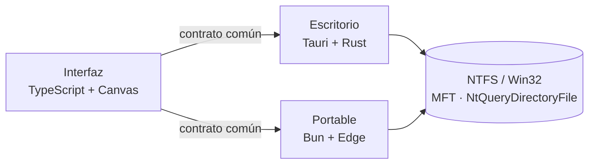

<div align="center">

# TesseraFS

**Mira tu disco como un mosaico. Encuentra lo que ocupa en segundos.**

Analizador de espacio en disco para Windows y Linux, de código abierto, rápido y local.


<sub>Captura de la edición demo con datos de ejemplo.</sub>

</div>

## Qué hace

- **Mapa de teselas:** cada archivo es una tesela con área proporcional a su tamaño, agrupada bajo la cabecera de su carpeta. Lo grande salta a la vista.
- **Todo enlazado:** un clic en el mapa ubica el archivo en el árbol y el árbol marca su tesela. El panel de detalle muestra ruta, tamaño, espacio en disco y acciones.
- **Rápido de verdad:** lee la tabla maestra de archivos de NTFS. **1,5 millones de elementos en 1,8 s** con permisos de administrador, y 4–5 s sin ellos.
- **Tres formas de colorear:** por categoría (vídeo, juegos, compilación…), por extensión o por antigüedad, para encontrar lo que lleva años sin tocarse.
- **Filtros potentes:** `ext:gguf size:>1g`, `age:>2y size:>500m`, `path:Downloads ext:msi,exe`…
- **Liberar espacio con criterio:** propone candidatos como Seguro, Revisar o No borrar a mano, con la orden o el ajuste correcto para cada uno.
- **Privado y prudente:** nada sale de tu equipo; sólo lee el disco; borra únicamente a la Papelera y siempre con confirmación.
- **En tu idioma:** English, Español, Português (Brasil), Français y Deutsch, con el idioma de Windows por defecto y cambio al instante ([cómo se traduce](docs/tecnica/i18n.md)).

<table>
<tr>
<td><br/><sub><b>Liberar espacio</b>: candidatos con su nivel de riesgo</sub></td>
<td><br/><sub><b>Antigüedad</b>: de reciente (ámbar) a olvidado (índigo)</sub></td>
</tr>
<tr>
<td><br/><sub><b>Relieve</b> con color por extensión</sub></td>
<td><br/><sub><b>Escaneo</b> con progreso real</sub></td>
</tr>
</table>

## Ediciones

| | Escritorio | Portable |
|---|---|---|
| Qué es | `tesserafs-desktop.exe` (≈11 MB) | Carpeta con `bun.exe` + `tesserafs.js` + lanzador |
| Motor | Rust | TypeScript sobre Bun |
| Ventana | Tauri 2 + WebView2 | Microsoft Edge en modo aplicación |
| C:\ con 1,5 M elementos | **1,8 s** con admin · 4–5 s sin admin | 9 s con admin · 5–6 s sin admin |
| Para | Tu equipo | Empresas donde el antivirus bloquea ejecutables sin firma: **no lleva ningún binario propio** |

Las dos comparten la misma interfaz y dan los mismos resultados.

## Empezar

**Usar:** descarga desde **[Releases](../../releases/latest)** el instalador de Windows (sin administrador), uno de los zips (sin instalar nada) o, en Linux, la AppImage o el `.deb`. Todo se explica en la **[Guía de usuario](docs/usuario/guia.md#descargar)** y en **[TesseraFS en Linux](docs/usuario/linux.md)**.

**Compilar** (Windows 10/11, [Bun](https://bun.sh) ≥ 1.3, [Rust](https://rustup.rs) estable):

```bash
bun install
```
```bash
bun run ui:build
```
```bash
bun run portable:dev
```
```bash
bun run desktop:dev
```

Sin compilar nada, `packages/ui/dist/index.html` abierto en el navegador es una demo con datos de ejemplo.

## Documentación

| Para usuarios | Para desarrolladores |
|---|---|
| [Guía de usuario](docs/usuario/guia.md) | [Arquitectura](docs/tecnica/arquitectura.md) |
| [Filtros](docs/usuario/filtros.md) | [Motores de escaneo](docs/tecnica/motores.md) |
| [Liberar espacio](docs/usuario/liberar-espacio.md) | [Interfaz y renderizado](docs/tecnica/interfaz.md) |
| [Preguntas frecuentes](docs/usuario/preguntas-frecuentes.md) | [Contrato interfaz ↔ motor](docs/ARQUITECTURA.md) |
| [TesseraFS en Linux](docs/usuario/linux.md) | |
| | [Guía de desarrollo](docs/tecnica/desarrollo.md) |
| | [Versiones y commits](docs/VERSIONES.md) · [Cambios](CHANGELOG.md) |

## Cómo funciona, en una imagen



El árbol completo (millones de nodos) vive en el motor. La interfaz sólo pide lo que va a mostrar: una porción binaria para el mapa, páginas de hijos para el árbol y búsquedas ya filtradas. Detalles en [Arquitectura](docs/tecnica/arquitectura.md).

## Code signing policy

*Política de firma de código.*

Free code signing provided by [SignPath.io](https://about.signpath.io/), certificate by [SignPath Foundation](https://signpath.org/).

| Role | Members |
|---|---|
| Committers and reviewers | [hernansp08-hub](https://github.com/hernansp08-hub) |
| Approvers | [hernansp08-hub](https://github.com/hernansp08-hub) |

Every signed file is built by the [GitHub Actions release workflow](.github/workflows/release.yml) from this repository, and each signing request is approved by hand.

**Privacy policy:** this program will not transfer any information to other networked systems unless specifically requested by the user or the person installing or operating it. TesseraFS scans, keeps its history and exports only on your computer; its interface makes no external requests.

> [!NOTE]
> La solicitud a SignPath Foundation está en trámite: hasta que se apruebe, los ejecutables publicados no están firmados.

## Licencia

A tu elección, [MIT](LICENSE-MIT) o [Apache-2.0](LICENSE-APACHE). Las fuentes incrustadas (Bricolage Grotesque e IBM Plex) se distribuyen bajo la SIL Open Font License 1.1: ver `packages/ui/fonts/licencias/`.
