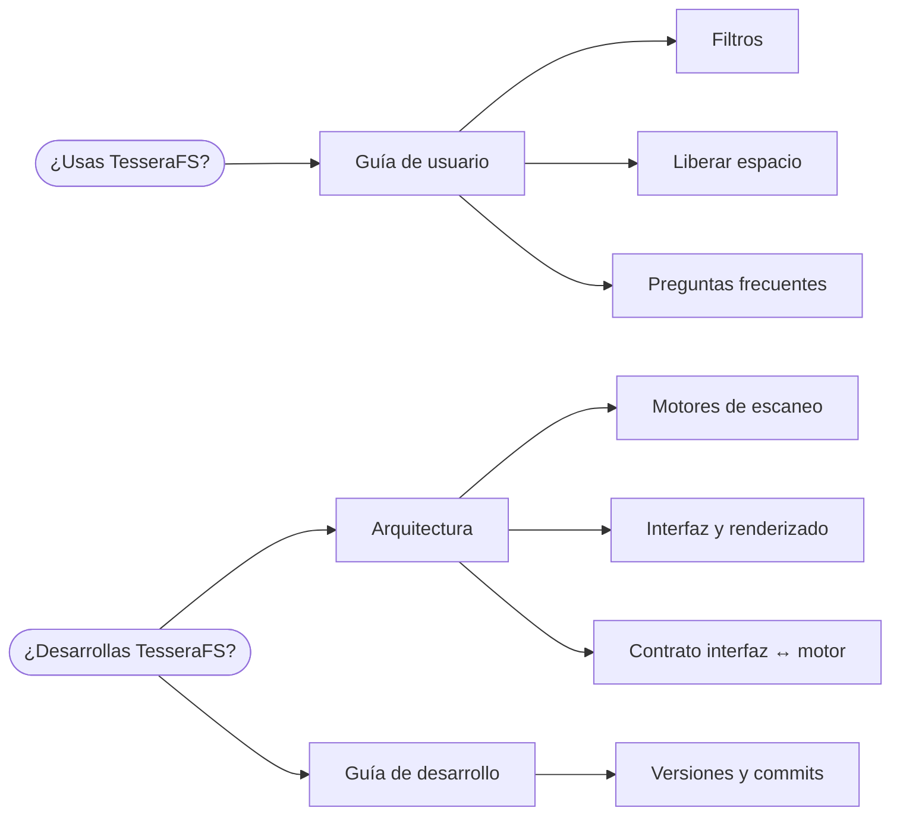

# Documentación de TesseraFS

## Para usuarios

| Documento | Qué encontrarás |
|---|---|
| [Guía de usuario](usuario/guia.md) | Qué edición elegir, primer escaneo, cómo leer el mapa, paneles, atajos y trucos |
| [Filtros](usuario/filtros.md) | La sintaxis completa de búsqueda y un recetario de consultas útiles |
| [Liberar espacio](usuario/liberar-espacio.md) | Qué propone la app, qué significa cada nivel de riesgo y cómo borrar con seguridad |
| [Preguntas frecuentes](usuario/preguntas-frecuentes.md) | Por qué los totales no coinciden con el Explorador, antivirus, permisos y problemas comunes |

## Para desarrolladores

| Documento | Qué encontrarás |
|---|---|
| [Arquitectura](tecnica/arquitectura.md) | Visión general, las dos ediciones, flujos de datos, seguridad y decisiones de diseño |
| [Motores de escaneo](tecnica/motores.md) | Lectura de la MFT, recorrido de carpetas, modelo de datos, enlaces duros y rendimiento |
| [Interfaz y renderizado](tecnica/interfaz.md) | Mapa de teselas (squarified, mosaico, relieve), selección, listas virtuales y color |
| [Contrato](ARQUITECTURA.md) | Operaciones, formato binario *slice* v1 y lenguaje de búsqueda que cumplen ambos motores |
| [Internacionalización](tecnica/i18n.md) | Catálogos por idioma, mensajes ICU, códigos de los motores, formatos, pseudolocalización y cómo añadir un idioma |
| [Guía de desarrollo](tecnica/desarrollo.md) | Preparar el entorno, compilar, probar, depurar y recetas para ampliar la app |
| [Versiones y commits](VERSIONES.md) | SemVer, Conventional Commits, ramas y cómo publicar una versión |

Las capturas de `img/` se generan con datos de ejemplo mediante [`scripts/capturas.ps1`](../scripts/capturas.ps1), así que nunca muestran el disco de nadie.
