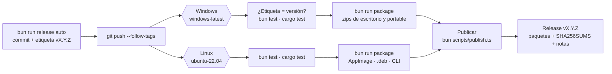

# Versiones y commits

## Número de versión: SemVer, uno para todo el producto

`MAYOR.MENOR.PARCHE`, por ejemplo `0.3.2`. Las dos ediciones, la interfaz, los motores y la CLI comparten **un único número**, porque se publican juntas y deben entenderse entre sí. Ese número vive en `package.json` (raíz y paquetes), `Cargo.toml` (`[workspace.package]`) y `tauri.conf.json`. Nunca se edita a mano: lo cambia `bun run release`. La interfaz lo muestra en la barra de estado (`· v0.1.0`), lo que ayuda con los informes de errores.

| Sube | Cuándo | Ejemplo |
|---|---|---|
| PARCHE | Correcciones sin cambios visibles de comportamiento | 0.1.0 → 0.1.1 |
| MENOR | Funciones nuevas | 0.1.1 → 0.2.0 |
| MAYOR | Cambios incompatibles (formato de escaneos guardados, CLI, contrato) | 1.4.0 → 2.0.0 |

Mientras la versión empiece por `0.`, el proyecto se considera en desarrollo: los cambios incompatibles suben la MENOR. La **1.0.0** llega cuando se cumpla esto:
- el modo MFT está probado en varios equipos;
- el ejecutable está firmado y tiene instalador;
- el contrato entre interfaz y motores no va a cambiar a menudo.

Para probar antes de publicar se usan prerreleases: `0.2.0-beta.1`, `0.2.0-beta.2`… y luego `0.2.0`.

El formato binario "slice" lleva su propio número (`version = 1` en la cabecera, ver [ARQUITECTURA.md](ARQUITECTURA.md)). Sólo sube si cambia ese formato.

## Mensajes de commit: Conventional Commits

```
tipo(ámbito opcional): descripción en imperativo
```

| Tipo | Para | Entra en el CHANGELOG como |
|---|---|---|
| `feat` | Función nueva | Añadido |
| `fix` | Corrección | Corregido |
| `perf` | Mejora de rendimiento | Rendimiento |
| `refactor` | Cambio interno sin efecto visible | Cambiado |
| `docs`, `test`, `build`, `ci`, `chore` | Lo demás | No aparece |

Un `!` tras el tipo (`feat(protocol)!: …`) o la línea `BREAKING CHANGE:` en el cuerpo marcan un cambio incompatible.

Ámbitos habituales: `ui`, `core` (Rust), `core-bun`, `portable`, `desktop`, `cli`, `protocol`.

Ejemplos:
- `feat(ui): divisores para redimensionar los paneles`
- `fix(core-bun): no contar dos veces los enlaces duros`
- `perf(core-bun): leer la MFT con varios hilos`

## Ramas

Desarrollo en **tronco**:
- `main` siempre compila y pasa las pruebas;
- cada cambio va en una rama corta (`feat/cancelar-escaneo`, `fix/rutas-largas`) que se integra en `main`;
- las versiones son etiquetas `vX.Y.Z` sobre `main`. Una corrección urgente para una versión antigua sale de su etiqueta en una rama `release/0.3`.

## Publicar una versión

Publicar es **crear la etiqueta y subirla**. GitHub Actions hace el resto: compila, prueba, empaqueta y crea la *release* con los zips.

```bash
bun run release auto --dry
```
Muestra la versión siguiente y la entrada del CHANGELOG sin tocar nada.

```bash
bun run release auto
```
Sube el número en todos los manifiestos, escribe el CHANGELOG, hace el commit `chore(release): vX.Y.Z` y crea la etiqueta.

```bash
git push --follow-tags
```
Sube el commit y la etiqueta: esto **lanza la publicación automática**.

Otras formas de `release`: `patch`, `minor`, `major`, `minor --pre=beta` (→ `0.2.0-beta.1`), `pre` (→ `beta.2`), `final` (quita el sufijo) o un número exacto.

### Qué hace GitHub Actions



| Paso | Detalle |
|---|---|
| Comprobación | La etiqueta (`v0.3.0`) debe coincidir con la versión de `package.json`; si no, el flujo se detiene |
| Herramientas | Bun **1.3.14** fijado en el flujo (es el `bun.exe` que viaja en la portable) y Rust estable, con caché de compilación |
| Pruebas | Windows: `bun test` y `cargo test --workspace --release`. Linux: las de la interfaz, i18n y protocolo (el motor portable es sólo de Windows) y `cargo test`. Si fallan en cualquiera de los dos, **no se publica nada** |
| Paquetes | Cada sistema ejecuta `bun run package` y guarda sus paquetes como artefacto |
| Publicación | El trabajo «Publicar» junta los paquetes de los dos y ejecuta `bun scripts/publish.ts`: sumas, notas y release. Si la release ya existe, reemplaza sus archivos y notas, así que el flujo se puede relanzar |
| Duración y coste | Unos 15–25 min con caché, con Windows y Linux en paralelo. En un repositorio privado consume minutos de Actions (los de Windows cuentan doble; los de Linux, sencillos) |

Sigue el progreso en la pestaña **Actions** del repositorio o con `gh run watch`.

**Probar sin publicar:** en *Actions › Publicar versión › Run workflow* (o `gh workflow run release.yml`), el flujo compila y empaqueta la rama elegida. Los paquetes quedan como artefactos del flujo durante 7 días, sin crear ninguna release.

### Qué se publica

| Archivo | Contenido |
|---|---|
| `TesseraFS-X.Y.Z-instalador-win-x64.exe` | Instalador NSIS de la app de escritorio: por usuario, sin administrador, en los cinco idiomas; se desinstala desde Configuración y conserva el historial |
| `TesseraFS-X.Y.Z-escritorio-win-x64.zip` | `tesserafs-desktop.exe`, `tessera-cli.exe` ([línea de comandos](usuario/linea-de-comandos.md)), `README.txt` (en los cinco idiomas), `LICENCIAS-TERCEROS.txt` (crates de Rust incluidos) y `licencias/` |
| `TesseraFS-X.Y.Z-portable-win-x64.zip` | `bun.exe` (firmado, sin modificar), `tesserafs.js`, lanzadores, `README.txt` (en los cinco idiomas), avisos de Bun y `licencias/` |
| `TesseraFS-X.Y.Z-linux-x86_64.AppImage` | La app de escritorio para Linux, sin instalar ([guía](usuario/linux.md)) |
| `TesseraFS-X.Y.Z-linux-amd64.deb` | La misma app como paquete de Debian y Ubuntu |
| `TesseraFS-X.Y.Z-cli-linux-x64.tar.gz` | `tessera-cli` para Linux, `LICENCIAS-TERCEROS.txt` y `licencias/` |
| `SHA256SUMS.txt` | Sumas para comprobar las descargas (`Get-FileHash archivo.zip` en Windows, `sha256sum -c SHA256SUMS.txt --ignore-missing` en Linux) |

Las versiones con sufijo (`-beta.1`) se publican como *prerelease*.

### Gestores de paquetes (winget, Scoop, AUR)

> [!IMPORTANT]
> Los commits en esos repositorios deben ir con la dirección anónima de GitHub, como los de este. Los que se crean con la API de GitHub (o editando en la web) usan el correo de la cuenta salvo que se indique otro autor.

Después de publicar una versión, `bun run manifests` genera en `dist/manifiestos/vX.Y.Z/` los manifiestos con las sumas de la propia release (las lee de `SHA256SUMS.txt` en GitHub). No envía nada: cada gestor se actualiza desde tu cuenta.

| Gestor | Qué se genera | Cómo se publica |
|---|---|---|
| **winget** | `winget/manifests/t/TesseraFS/TesseraFS/X.Y.Z/` (versión, instalador NSIS por usuario y descripción) | Un *pull request* a [microsoft/winget-pkgs](https://github.com/microsoft/winget-pkgs) desde la bifurcación `hernansp08-hub/winget-pkgs`, en una rama `TesseraFS.TesseraFS-X.Y.Z` (o `wingetcreate submit`). La primera vez hay que aceptar el acuerdo de colaboración (CLA) que pide su bot. Lo revisan sus validadores; después: `winget install TesseraFS.TesseraFS` |
| **Scoop** | `scoop/tesserafs.json` (zip de escritorio, con `tessera-cli` en el PATH de Scoop y acceso directo) | *Bucket* propio: [hernansp08-hub/scoop-tesserafs](https://github.com/hernansp08-hub/scoop-tesserafs), con el manifiesto en `bucket/tesserafs.json`. En cada versión se sube el nuevo. Se instala con `scoop bucket add tesserafs https://github.com/hernansp08-hub/scoop-tesserafs` y `scoop install tesserafs` |
| **AUR** | `aur/tesserafs-bin/PKGBUILD` y `.SRCINFO` (a partir del `.deb` y del CLI de Linux) | Con una cuenta de AUR y una clave SSH: `git clone ssh://aur@aur.archlinux.org/tesserafs-bin.git`, copiar los dos archivos, `git commit` y `git push` |

### Publicar desde tu equipo (alternativa)

Si GitHub Actions no está disponible, el mismo script funciona en local con `gh` autenticado (publica los paquetes del sistema donde se ejecuta; en Windows, sólo los zips):

```bash
bun run package --publish
```

Sin `--publish` sólo deja los archivos en `dist/release/vX.Y.Z/` para revisarlos; `--skip-build` reutiliza lo ya compilado.

### Pendiente: firma de código

Se ha pedido el certificado gratuito de **SignPath Foundation** para proyectos open source. La [política de firma](../README.md#code-signing-policy) ya está en el README y en las notas de cada release. Cuando se apruebe, el flujo enviará a firmar `tesserafs-desktop.exe`, `tessera-cli.exe` y el instalador antes de empaquetarlos, y cada firma se aprobará a mano en SignPath. Así desaparece el aviso de SmartScreen y los antivirus confían más en el ejecutable.

Lo que pide SignPath y cómo se cumple:

| Requisito | En TesseraFS |
|---|---|
| Licencia OSI sin licencia comercial dual, sin componentes propietarios | MIT o Apache-2.0; dependencias abiertas (ver `LICENCIAS-TERCEROS.txt` de cada paquete) |
| Ya publicado y documentado en la página de descarga | Releases de GitHub con notas y tabla de descargas |
| Política de firma en la portada y en la descarga | README › Code signing policy y notas de cada release |
| Compilación verificable en un sistema de confianza | GitHub Actions con runners de GitHub; la compilación firmada no reutiliza cachés anteriores |
| Metadatos del archivo | Nombre de producto «TesseraFS» y la misma versión en todos los archivos de una compilación |
| Autenticación de dos factores | En GitHub y en SignPath para todo el equipo |
| Instalar implica poder desinstalar | Los zips no se instalan; el `.deb` y el instalador de Windows se desinstalan desde el sistema |
