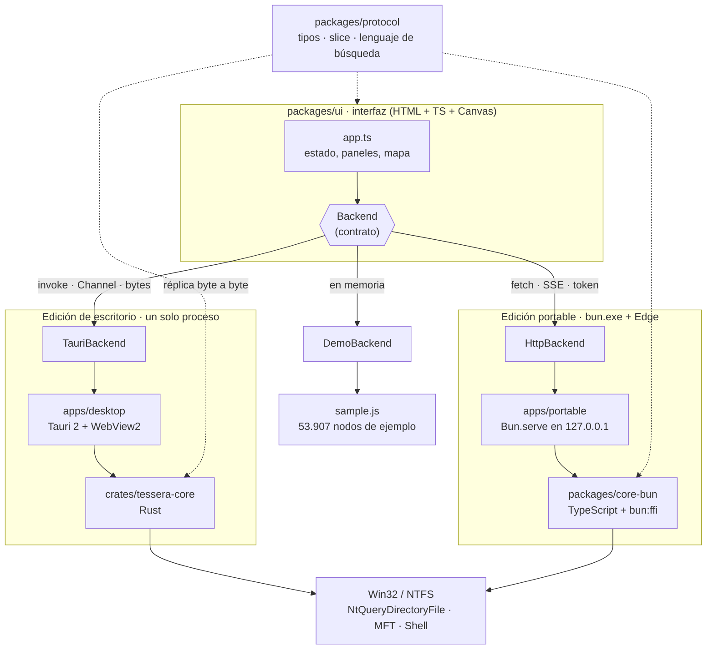
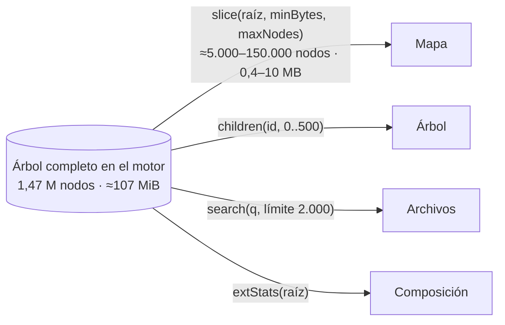
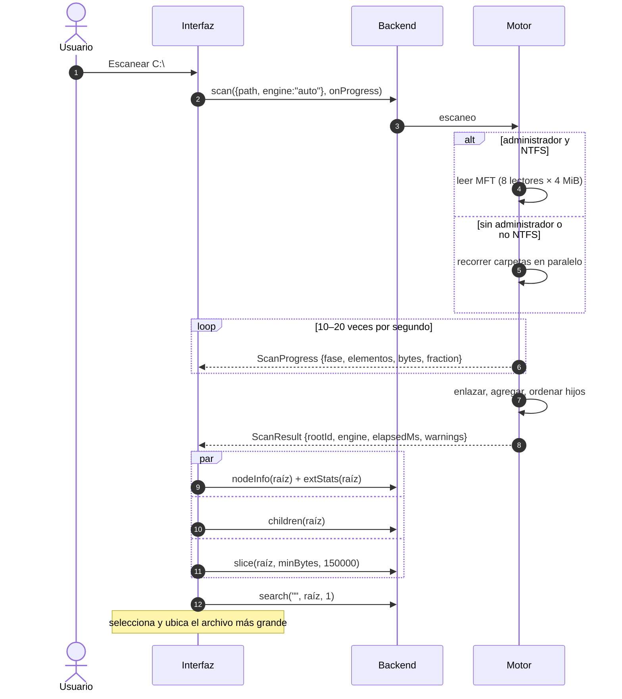
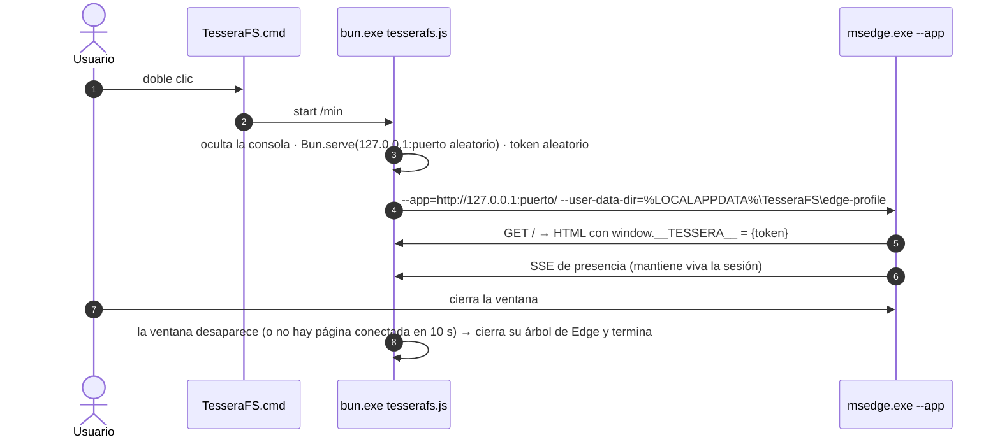
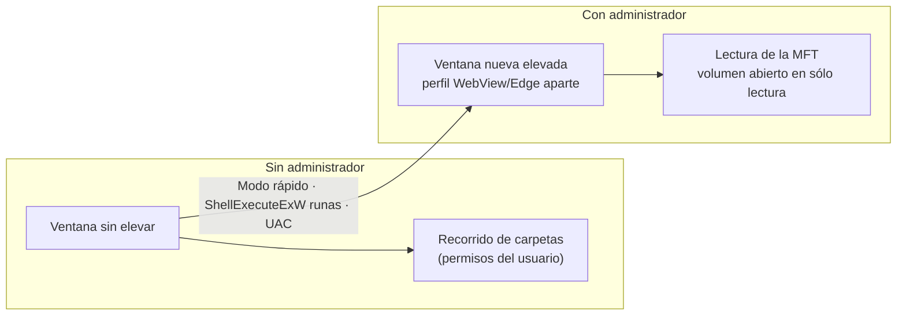

# Arquitectura

TesseraFS es **una interfaz y dos motores intercambiables**. La interfaz (TypeScript + Canvas) sólo habla con una abstracción, `Backend`. Debajo hay un motor en Rust (edición de escritorio), otro en TypeScript sobre Bun (edición portable) y un motor de demostración con datos de ejemplo.



## Por qué dos ediciones

El cuello de botella no es el lenguaje: es **la confianza del sistema en el ejecutable**. Los antivirus corporativos bloquean ejecutables sin firma ni reputación, sin importar en qué estén escritos.

| | Escritorio | Portable |
|---|---|---|
| Motor | Rust, compilado | TypeScript en el runtime de Bun |
| Ventana | Tauri 2 + WebView2 | Microsoft Edge con `--app` |
| Binario propio | `tesserafs-desktop.exe`, 10,8 MB, CRT estático | **Ninguno** |
| Firma | Pendiente (SignPath, Azure Artifact Signing) | `bun.exe` (Codeblog CORP) y `msedge.exe` (Microsoft) ya firmados |
| Transporte | IPC en proceso | HTTP local |

La comparación que llevó a elegir Edge para la portable, comprobada con `Get-AuthenticodeSignature`:

| Envoltorio evaluado | Resultado |
|---|---|
| Edge `--app` + `bun.exe` | ✅ Todo firmado; Edge ya viene con Windows |
| Neutralino 6.10 | ❌ `neutralino-win_x64.exe` sin firmar |
| NW.js 0.117 | ❌ 11 de 13 binarios sin firmar; 539 MB |
| Buntralino | ❌ Compila a un exe sin firmar; sin actualizaciones desde febrero de 2025 |
| `bun build --compile` | ❌ Genera un exe nuevo de 94 MB sin firma |
| Python (CPython) | ❌ Recorrido de C:\ en 15–36 s; parseo de la MFT ≈20× más lento que en Bun |

## Estructura del repositorio

```text
packages/
  protocol/      contrato: types.ts · slice.ts (codec binario) · query.ts (lenguaje de búsqueda)
  ui/            interfaz: index.html, src/{app,render,colors,format,main}.ts, backends/, fonts/
  core-bun/      motor Bun: win32.ts (FFI) · walk.ts + walkworker.ts · mft.ts · store.ts · engine.ts
apps/
  portable/      src/main.ts (servidor + Edge) · src/ui-macro.ts · pack.ts
  desktop/       src-tauri/ (Tauri 2: main.rs, tauri.conf.json, capabilities/)
crates/
  tessera-core/  motor Rust: scan · walk · mft · build · tree · ops · query · slice · sys · attrs · names
  tessera-cli/   herramienta de línea de comandos y pruebas cruzadas
bench/           mediciones iniciales en Bun, Node, Rust y Python
scripts/         release.ts (versiones) · capturas.ps1 (imágenes de la documentación)
docs/            esta documentación
```

## El contrato

Toda la comunicación pasa por las operaciones de [`Backend`](../../packages/protocol/src/types.ts), documentadas en [Contrato](../ARQUITECTURA.md):

| Operación | Para qué la usa la interfaz | Respuesta |
|---|---|---|
| `volumes` | Selector de unidad | JSON |
| `scan` | Botón Escanear; el progreso llega por un canal | JSON + eventos |
| `slice` | Dibujar el mapa de la carpeta actual | **Binario** |
| `children` | Filas del árbol, por páginas de 500 | JSON |
| `search` | Filtro, «Archivos más grandes» y reglas de Liberar espacio | JSON |
| `extStats` | Panel Composición | JSON |
| `nodePath` · `nodeInfo` | Panel de detalle, ubicar en el árbol | JSON |
| `action` | Abrir, Explorador, Propiedades, Papelera | JSON |
| `elevation` · `relaunchElevated` | Botón «Modo rápido» | JSON |

### Por qué no se envía el árbol entero

Un disco típico tiene 1,5 millones de elementos. Como objetos JavaScript serían cientos de megabytes, y en Windows el puente WebView2 rinde unos 50 MB/s. Por eso **el árbol completo vive en el motor**, y la interfaz pide sólo lo que necesita:



El *slice* incluye sólo los nodos de al menos `minBytes`. La interfaz lo calcula para que cada nodo ocupe como mínimo 1,5 píxeles de pantalla. Lo descartado de cada carpeta se resume en `restSize`/`restCount` y se dibuja como una tesela rayada. Sobre C:\ completo, un slice típico tiene unos 5.400 nodos y pesa 443 KB.

## Flujo de un escaneo



### Transporte en cada edición

| | Tauri | HTTP (portable) |
|---|---|---|
| Llamadas | `window.__TAURI__.core.invoke(cmd, args)` | `fetch('/api/…')` con cabecera `X-Tessera-Token` |
| Slice binario | `tauri::ipc::Response` (bytes sin JSON) | `application/octet-stream` |
| Progreso | `Channel<ScanProgress>` | Server-Sent Events en `/api/events`, leídos con `fetch` porque `EventSource` no admite cabeceras |
| Estado | `Mutex` gestionado por Tauri | Una instancia de `TesseraEngine` en el servidor |

## Ciclo de vida de la edición portable



Detalles:
- El perfil de Edge propio aísla la ventana. Sólo se cierra el árbol de procesos que lanzó TesseraFS; las demás ventanas de Edge del usuario no se tocan.
- La interfaz va incrustada en `tesserafs.js` en tiempo de empaquetado mediante una macro de Bun.
- `tesserafs.js` se carga a sí mismo como *worker* para el recorrido paralelo, así que la carpeta no necesita más archivos.

## Seguridad



| Medida | Dónde |
|---|---|
| El volumen se abre sólo con `GENERIC_READ`; nunca se escribe en él | Ambos motores |
| El escaneo no abre el contenido de los archivos, para no descargar los de la nube | Ambos motores |
| El servidor escucha sólo en `127.0.0.1` y en un puerto aleatorio | Portable |
| Token aleatorio comparado en tiempo constante; sin token, `401` | Portable |
| Se comprueba la cabecera `Host` contra el *DNS rebinding* (`403`) | Portable |
| Sin cabeceras CORS, y `X-Frame-Options: DENY` en la página | Portable |
| CSP sin orígenes externos; fuentes incrustadas | Escritorio y toda la interfaz |
| La elevación usa un perfil de navegador aparte, para no compartir datos entre procesos con y sin privilegios | Ambos |
| Borrar sólo a la Papelera (`IFileOperation`/`SHFileOperationW`), con confirmación en la interfaz | Ambos |

> [!NOTE]
> En la versión actual, «Modo rápido» relanza **la aplicación entera** con privilegios. El siguiente paso es un proceso auxiliar elevado y mínimo, sin interfaz, que hable con la ventana normal por una tubería con nombre: es lo que recomienda Microsoft para WebView2.

## Decisiones principales

| Decisión | Motivo |
|---|---|
| El árbol vive en el motor; la interfaz pide porciones | Memoria y ancho de banda del puente WebView2 |
| Formato binario propio para el mapa | 64 bytes por nodo y sin JSON: un slice de C:\ completo (443 KB) se genera, viaja y se decodifica en decenas de milisegundos |
| El mapa se pinta en la CPU sobre un `ImageData` | Es sencillo y portable, con coste acotado por los píxeles de pantalla. WebGL queda como mejora futura. |
| Lenguaje de búsqueda propio, evaluado en el motor | Mismo comportamiento en las dos ediciones; 80–300 ms sobre 1,5 M nodos |
| Una única versión para todo el producto | Las piezas se publican juntas (ver [Versiones](../VERSIONES.md)) |
| Licencia MIT o Apache-2.0 y nada de código GPL | Reutilizable como biblioteca; implementación a partir de documentación pública y artículos |
