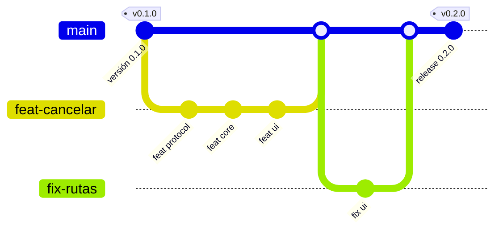
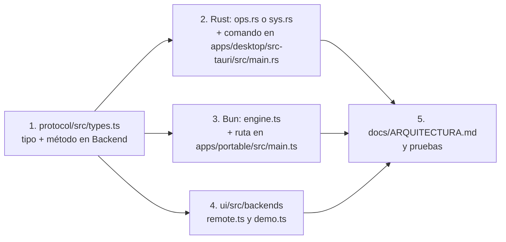

# Guía de desarrollo

## Requisitos

| Herramienta | Versión | Para |
|---|---|---|
| Windows | 10 u 11 x64 | Los motores usan la API de Windows |
| [Bun](https://bun.sh) | 1.3 o posterior | Interfaz, motor portable, scripts y pruebas de TypeScript |
| [Rust](https://rustup.rs) | 1.94 estable (MSVC) | Motor de escritorio, CLI y Tauri |
| WebView2 | Incluido en Windows 11 | Edición de escritorio |
| Microsoft Edge | Incluido en Windows | Edición portable |

El CLI de Tauri no hace falta instalarlo aparte: se usa con `bunx tauri` desde `apps/desktop`.

## Primeros pasos

```bash
bun install
```
```bash
bun run ui:build
```
Abre `packages/ui/dist/index.html` en el navegador: es la **demo** con datos de ejemplo. Para probar con tu disco:
```bash
bun run portable:dev
```
```bash
bun run desktop:dev
```

## Comandos

| Comando | Qué hace |
|---|---|
| `bun run ui:build` | Construye la interfaz en `packages/ui/dist/index.html` (y la demo en `dist-demo/`) |
| `bun run portable:dev` | Arranca la edición portable desde el código, con su ventana de Edge |
| `bun run portable:pack` | Genera `apps/portable/dist/TesseraFS-portable/` y comprueba la firma de `bun.exe` |
| `bun run desktop:dev` | Edición de escritorio en modo desarrollo |
| `cd apps/desktop && bunx tauri build --no-bundle` | `target/release/tesserafs-desktop.exe` sin instalador |
| `bun run desktop:build` | Igual, más el instalador NSIS |
| `cargo build --release -p tessera-cli` | Herramienta de línea de comandos |
| `bun test` | Pruebas de TypeScript (protocolo, interfaz, motor Bun, catálogos de idiomas) |
| `cargo test --workspace` | Pruebas de Rust |
| `bun run release <tipo>` | Sube la versión, escribe el CHANGELOG, hace el commit y la etiqueta (ver [Versiones](../VERSIONES.md)) |
| `bun run package` | Compila las dos ediciones y genera los zips, sumas y notas en `dist/release/vX.Y.Z/` |
| `bun run package --publish` | Además crea (o actualiza) la release en GitHub con `gh`; normalmente lo hace GitHub Actions |
| `bun run i18n:check` | Estado de las traducciones: claves que faltan, que sobran o idénticas al inglés (`--same`, `--strict`) |
| `bun packages/ui/scripts/serve.ts` | Sirve la interfaz compilada con el motor demo en `http://127.0.0.1:47801` (prueba con `#lang=de` o `#pseudo`) |
| `TESSERA_HISTORY_DIR=… TESSERA_EXPORT_DIR=… bun run portable:dev` | La portable con historial y exportaciones en carpetas de prueba (la configuración `portable-pruebas` de `.claude/launch.json` usa `dist/pruebas/`) |
| `tessera-cli scan <ruta> --history-save` · `--history-compare <id>` · `tessera-cli history list` | Historial desde la línea de comandos, para comprobar resúmenes entre motores |
| `tessera-cli scan <ruta> --dups <bytes> [--dups-out f.json]` | Búsqueda de duplicados desde la línea de comandos |
| `pwsh scripts/capturas.ps1 [-Lang es]` | Regenera las capturas de la documentación (en español por defecto) |

> [!IMPORTANT]
> Tauri y la portable incrustan `packages/ui/dist/index.html` al compilar. Después de cambiar la interfaz, ejecuta `bun run ui:build` **antes** de compilar el escritorio o empaquetar la portable.

## Flujo de trabajo



1. Crea una rama corta desde `main`: `feat/…`, `fix/…` o `perf/…` (en el diagrama, `feat-cancelar` y `fix-rutas`).
2. Haz commits con [Conventional Commits](../VERSIONES.md#mensajes-de-commit-conventional-commits).
3. Comprueba que todo esté en verde (`bun test` y `cargo test --workspace`) e integra en `main`.
4. Cuando toque, ejecuta `bun run release auto` en `main` y `git push --follow-tags`. Al llegar la etiqueta a GitHub, el flujo [`.github/workflows/release.yml`](../../.github/workflows/release.yml) prueba, empaqueta y publica la release (detalles en [Versiones](../VERSIONES.md#qué-hace-github-actions)).

## Pruebas

| Suite | Qué cubre | Cómo |
|---|---|---|
| `packages/protocol/test` | Lenguaje de búsqueda y codec del slice | `bun test packages/protocol` |
| `packages/ui/test` | El motor demo cumple el contrato | `bun test packages/ui` |
| `packages/core-bun/test` | Almacén, parser MFT con registros sintéticos, recorrido real de una carpeta temporal, mensajes con código | `bun test packages/core-bun` |
| `packages/i18n/test` | Catálogos (claves, ICU, argumentos, etiquetas, francés), formatos, negociación y uso de las claves en código y motores | `bun test packages/i18n` |
| `crates/tessera-core` | Parser MFT, slice, búsqueda, recorrido | `cargo test --workspace` |
| Prueba cruzada Rust ↔ TS | Mismo slice byte a byte y mismas búsquedas | `bun crates/tessera-cli/tests/crosscheck.ts` (tras generar los archivos con `tessera-cli`) |

Variables útiles:
- `TESSERA_TEST_DIR`: carpeta donde las pruebas de Bun crean sus archivos.
- `TESSERA_TEST_TRASH=1`: incluye la prueba que manda un archivo temporal a la Papelera. En Rust, `cargo test -p tessera-core --test walk -- --ignored papelera`.

## Depurar

### Edición portable

```bash
bun apps/portable/src/main.ts --debug
```
Deja la consola visible con los mensajes del servidor.

```bash
bun apps/portable/src/main.ts --no-window
```
Sólo levanta el servidor e imprime la URL y el token, para probar la API con `curl`.

Otras opciones:
- `--threads=N` cambia el número de *workers* del recorrido; `--threads=0` recorre en un solo hilo.
- La variable `TESSERA_PORT` fija el puerto.

### Edición de escritorio

Para inspeccionar el WebView2 con las herramientas de desarrollo de Edge:
```powershell
$env:WEBVIEW2_ADDITIONAL_BROWSER_ARGUMENTS = "--remote-debugging-port=9333"; .\target\release\tesserafs-desktop.exe
```
Abre `edge://inspect` o `http://127.0.0.1:9333/json`.

### Motor Rust desde la línea de comandos

```bash
target/release/tessera-cli scan C:\ --engine walk --top 20 --progress
```

En una terminal **elevada**, para comparar los dos motores carpeta por carpeta:
```bash
target/release/tessera-cli scan C:\ --compare
```

`--slice-out`, `--search`, `--json-out`, `--flags`, `--children` y `--repeat N` sirven para pruebas y mediciones. Ejecutar `tessera-cli` sin argumentos muestra todas las opciones.

## Recetas

### Añadir una regla a «Liberar espacio»

Las reglas son filtros con explicación, en `RULES` dentro de `packages/ui/src/clean.ts`. Ese módulo no depende de la interfaz, así que se prueba con rutas reales en `packages/ui/test/clean.test.ts`. La misma regla alimenta la tarjeta de la pestaña y el bloque «¿Qué es esto?» del panel de detalle.

```ts
{ id: 'gradleCache', q: 'type:dir name:caches', risk: 'ok',
  ok: t => /\\\.gradle\\caches$/i.test(t.path), min: 200 * MB },
```

| Campo | Para qué |
|---|---|
| `id` | Sus textos van en el catálogo: `clean.<id>.title` y `clean.<id>.why` |
| `q` | Consulta del lenguaje de búsqueda que trae los candidatos (se ejecuta en el motor) |
| `ok` | Filtro adicional sobre el nombre, la ruta o la extensión; también decide el «¿Qué es esto?» |
| `needs` | Hijos que confirman el candidato, como `['cachedir.tag']` en un `target` de Rust |
| `title` | Título que depende del elemento: devuelve una clave y sus parámetros (`['clean.game.title', { name }]`) |
| `cmd` | Orden que se puede copiar; una función si depende de la ruta |
| `how` | Ajuste de Windows: `true` usa `clean.<id>.how`; un id usa el de otra regla (`'temp'`) |
| `min` | Tamaño mínimo para proponerlo en la pestaña |
| `group` | Agrupa los archivos por carpeta; al marcar, se marcan los archivos y no la carpeta |
| `risk` | `ok`, `warn` o `bad` (las de `bad` no se pueden marcar desde la tarjeta) |

Si el candidato puede estar dentro de un programa instalado, excluye esas rutas con `INSTALLED`. Añade casos positivos y negativos a `clean.test.ts`: la prueba comprueba que la consulta `q` de verdad trae el ejemplo y que `ok` lo acepta. Los textos van en los cinco catálogos; `bun test packages/i18n` avisa si falta alguno.

Para explicar una carpeta que no es candidata a limpieza, añádela a `KNOWN` con su expresión regular y su texto `known.<id>`.

### Añadir una operación al contrato



Mantén los nombres en camelCase en JSON (`serde(rename_all = "camelCase")` en Rust) y los tamaños en bytes como números. Si cambia el formato del slice, sube su número de versión.

### Añadir o cambiar un texto

1. Añade la clave a `packages/i18n/locales/en.json` (y una nota en `_context.json` si puede ser ambigua) y tradúcela en los demás catálogos.
2. En el HTML: `data-i18n="clave"` (o `-html`, `-title`, `-aria`, `-placeholder`). En el código: `t('clave', { params })`, `html()` si lleva `<b>`/`<code>`, o `tk()` si la clave se compone.
3. Si el texto sale de un motor, no lo escribas en el motor: añade un código a la tabla de [i18n](i18n.md#mensajes-de-los-motores), su texto de reserva en inglés en `crates/tessera-core/src/msg.rs` y `packages/core-bun/src/messages.ts`, y la clave `engine.<código>`.
4. `bun run i18n:check` y `bun test packages/i18n`.

Detalles y convenciones en [Internacionalización](i18n.md).

### Añadir un idioma

Ver [Internacionalización › Añadir un idioma](i18n.md#añadir-un-idioma).

### Añadir una categoría de color

En `packages/ui/src/colors.ts`, añade una entrada a `CAT_DEF` con id, nombre, tono OKLCH (0–360°, lejos de los existentes) y extensiones separadas por espacios. Cada extensión debe pertenecer a una sola categoría.

### Probar el motor MFT de forma segura

El parser se prueba con registros sintéticos sin tocar el disco (`packages/core-bun/test/mft.test.ts` y las pruebas de `mft.rs`). Para un volumen real hace falta una terminal elevada: usa `tessera-cli scan C:\ --engine mft` o `--compare`. La lectura es siempre de sólo lectura.

## Convenciones

- Código y comentarios en español, breves; textos de la interfaz en español de España.
- Nunca nombres de productos de terceros en el código ni en la interfaz.
- Nada de código GPL: implementa a partir de documentación pública y cita la fuente en el comentario.
- La interfaz no puede hacer peticiones externas: incrusta cualquier recurso.
- Commits, ramas y versiones: [docs/VERSIONES.md](../VERSIONES.md).
