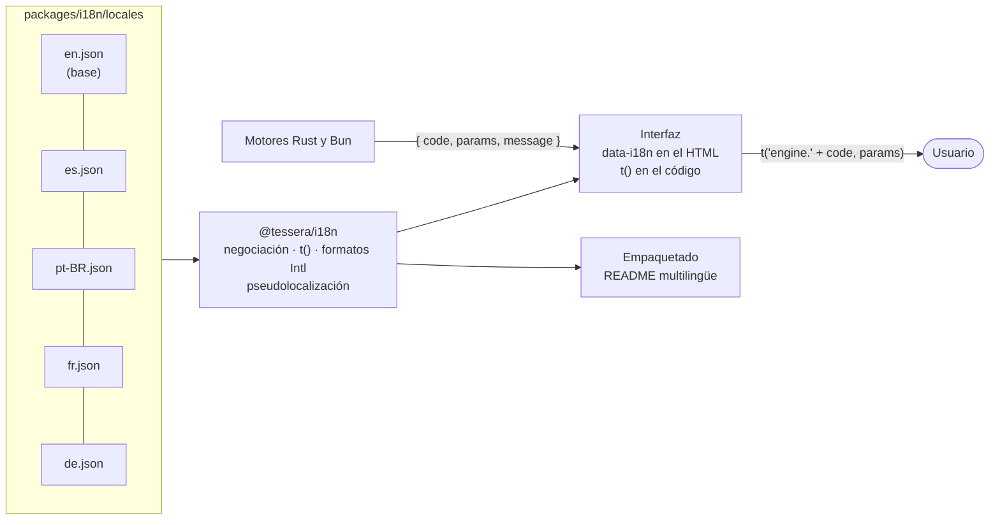
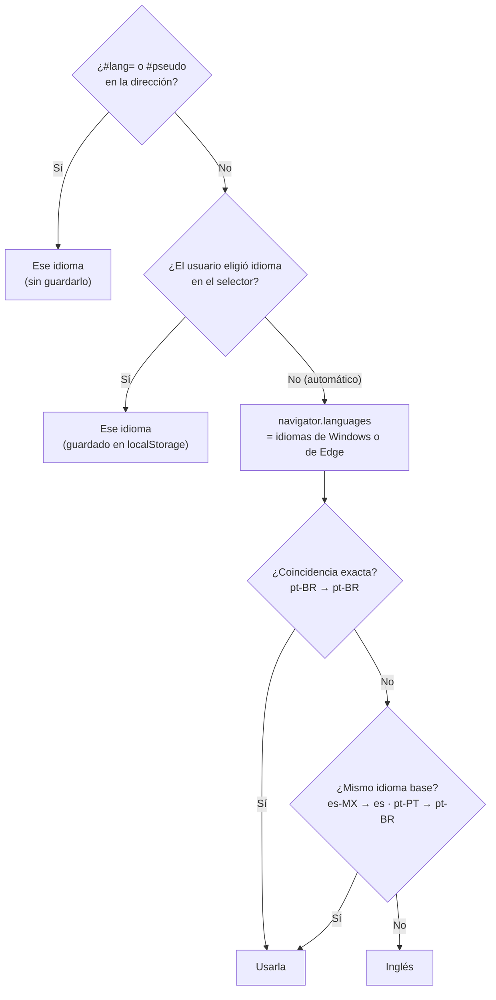
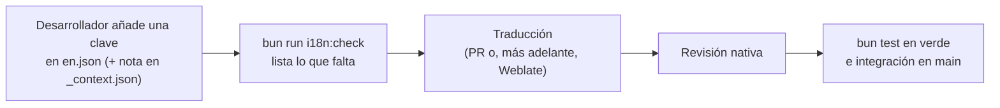

# Internacionalización (i18n)

TesseraFS se traduce con **un único catálogo de mensajes por idioma**. El inglés es la base y el idioma de reserva. Los motores nunca envían frases al usuario: envían **códigos**, y es la interfaz la que los traduce.

| Idioma | Código | Estado |
|---|---|---|
| English | `en` | Base y reserva |
| Español | `es` | Completo, mantenido por el equipo |
| Português (Brasil) | `pt-BR` | Primera versión, pendiente de revisión nativa |
| Français | `fr` | Primera versión, pendiente de revisión nativa |
| Deutsch | `de` | Primera versión, pendiente de revisión nativa |

## Principios

1. **Sin texto en el código.** Todo lo que lee el usuario sale del catálogo: botones, avisos, explicaciones, nombres de categoría, rutas de Ajustes de Windows…
2. **Frases completas con marcadores, nunca concatenadas.** `"{count} folders could not be read"`, nunca `count + " folders…"`. El orden de las palabras cambia entre idiomas.
3. **ICU MessageFormat** para plurales, selección y números: es el estándar que entienden Weblate, Crowdin y la mayoría de traductores.
   ```text
   {count, plural, one {# file} other {# files}}
   ```
4. **Formatos con `Intl`, no a mano:** números, porcentajes, unidades (`52,1 GB` en español, `52,1 Go` en francés), fechas y tiempo relativo («hace 4 días», «il y a 4 jours»).
5. **Los motores devuelven códigos y datos**, y la interfaz los traduce. El texto en inglés viaja también, como reserva y para los registros.
6. **Cambio de idioma en caliente**, sin reiniciar ni perder el escaneo.
7. **Comprobaciones automáticas.** Cada idioma tiene las mismas claves y marcadores que el inglés, cada mensaje es ICU válido y el HTML no lleva textos sin clave.
8. **Pseudolocalización** para encontrar textos sin traducir y diseños que se rompen con textos largos, antes de tener traductores.

## Arquitectura



### Elección del idioma



Si a un idioma le falta una clave, se usa la inglesa. En desarrollo, además, se avisa en la consola.

### Catálogos

- Un JSON por idioma, con **claves planas por áreas**: `header.scan`, `tree.col.size`, `clean.rustTarget.why`, `engine.scan.mftNeedsAdmin`…
- Las claves describen el **sitio**, no el texto: `tab.files` y no `files`. La misma palabra puede traducirse distinto según dónde aparezca.
- `en.json` es la fuente de la verdad. Las claves se tipan a partir de él (`MessageKey`) y una prueba recorre el código y el HTML: una clave mal escrita o que sobra hace fallar `bun test`.
- `_context.json` lleva notas para los traductores en las claves ambiguas, por ejemplo: «verbo en un botón; corto». No es un idioma: la interfaz no lo carga.
- Se permiten unas pocas etiquetas HTML (`<b>`, `<code>`, `<kbd>`, `<br>`) en textos con formato. La interfaz las filtra y escapa los parámetros.
- Apóstrofo tipográfico (’) en lugar del recto ('), que en ICU sirve para escapar llaves. El francés lleva espacio duro (`\u00a0`) antes de `:` `;` `?` `!` y dentro de « ».

### Mensajes de los motores

El contrato pasa de frases a objetos:

```ts
interface EngineMessage {
  code: string;                              // 'scan.mftNeedsAdmin'
  params?: Record<string, string | number>;  // { fs: 'FAT32' }
  message: string;                           // texto en inglés, de reserva y para registros
}
ScanResult.warnings: EngineMessage[]
ActionResult: { ok, code?, params?, message? }
Errores de las operaciones: EngineMessage (Tauri: Err(...); HTTP: cuerpo JSON con estado 4xx/5xx)
```

Los detalles técnicos internos (por ejemplo, «Extent de la MFT no alineado») viajan en inglés dentro del parámetro `error` de un código genérico como `scan.mftFailed`. Al usuario le basta con el mensaje traducido. Los errores del sistema que se muestran tal cual (como `FormatMessage` de Windows) ya llegan en el idioma de Windows.

| Código | Parámetros | Cuándo |
|---|---|---|
| `scan.mftNeedsAdmin` | — | MFT pedida o automática sin administrador |
| `scan.mftUnsupportedFs` | `fs` | Volumen que no es NTFS local |
| `scan.mftNetworkPath` | — | Ruta de red |
| `scan.mftFailed` | `error` | La lectura o construcción desde la MFT falló y se usó el recorrido |
| `scan.mftFragmented` | — | MFT muy fragmentada |
| `scan.mftBadRecords` | `count` | Registros con fixups inválidos ignorados |
| `scan.mftOrphans` | `count` | Entradas sin carpeta padre válida |
| `scan.accessDenied` | `count`, `sample`? | Carpetas sin permiso de lectura (`sample`: hasta 3 rutas de ejemplo, separadas por comas) |
| `scan.readErrors` | `count`, `sample`? | Carpetas con otros errores de lectura |
| `scan.demoData` | — | Edición demo |
| `dup.readErrors` | `count` | Archivos que no se pudieron leer al buscar duplicados (quedan fuera) |
| `history.notFound` | `id` | El resumen del historial no existe (404) |
| `history.otherRoot` | `path` | Se intentó comparar con el resumen de otra carpeta (409) |
| `history.saveFailed` | `error` | No se pudo escribir el resumen (500) |
| `history.readFailed` | `error` | El resumen está dañado o no se puede leer (500) |
| `export.invalidName` | `name` | Nombre de archivo vacío o con rutas (400) |
| `export.failed` | `error` | No se pudo escribir en Descargas\TesseraFS (500) |
| `export.notFound` | `path` | Se pidió mostrar algo que no está en Descargas\TesseraFS (404) |
| `error.invalidPath` | `path` | Ruta no válida o no absoluta |
| `error.notFolder` | `path` | La ruta no es una carpeta |
| `error.cannotOpen` | `path`, `error` | No se pudo abrir la ruta |
| `error.scanBusy` | — | Ya hay un escaneo en curso |
| `error.dupBusy` | — | Ya hay una búsqueda de duplicados en curso (también rechaza un escaneo nuevo) |
| `error.noScan` | — | Todavía no hay escaneo |
| `error.invalidNode` | `id` | Id de nodo desconocido |
| `error.cancelled` | — | Escaneo cancelado |
| `error.unsupportedPlatform` | — | Fuera de Windows |
| `error.internal` | `error` | Cualquier otro fallo |
| `action.trashed` | — | Movido a la papelera |
| `action.trashRoot` | — | Se intentó enviar la raíz del escaneo a la papelera |
| `action.trashNotMoved` | — | Windows no lo movió |
| `action.cancelled` | — | El usuario canceló la operación de Windows |
| `action.failed` | `error` | Error del sistema (ya localizado por Windows) |
| `action.unknown` | `kind` | Acción desconocida |
| `elevation.failed` | `error` | No se pudo relanzar con privilegios (por ejemplo, se canceló el UAC) |
| `query.invalidValue` | `value` | Valor no válido en el filtro (`size:>zz`) |
| `query.invalidType` | `value` | `type:` distinto de `dir` o `file` |
| `query.unknownKey` | `key` | Clave de filtro desconocida |
| `query.invalidRegex` | `error` | Expresión regular no válida en `re:` |
| `demo.open`, `demo.reveal`, `demo.properties`, `demo.trash` | `name` | Edición demo: lo que haría la app real |
| `demo.unavailable` | — | Acción que la demo no simula |

`ScanProgress.detail` sólo lleva **rutas**. El texto de cada fase lo pone la interfaz a partir de `phase` (`phase.<fase>`).

En el servidor portable, los errores de la API llevan su código HTTP: 400 para peticiones no válidas (`error.invalidPath`, `error.notFolder`, `error.cannotOpen`, `action.unknown`), 404 para `error.invalidNode`, 409 para conflictos de estado (`error.noScan`, `error.scanBusy`, `error.dupBusy`, `error.cancelled`, UAC cancelado) y 500 para `error.internal`. Las respuestas 401/403 (sin clave o de otro origen) son texto plano.

## Formatos por idioma

| Qué | Cómo | `es` | `en` | `fr` | `de` |
|---|---|---|---|---|---|
| Tamaño (base 1024) | `Intl.NumberFormat` con `style: 'unit'` | 52,1 GB | 52.1 GB | 52,1 Go | 52,1 GB |
| Bytes sueltos | símbolo corto, siempre separado | 512 B | 512 B | 512 o | 512 B |
| Número | `useGrouping: 'always'` | 1.536.697 | 1,536,697 | 1 536 697 | 1.536.697 |
| Porcentaje | `style: 'percent'` | 14,0 % | 14.0% | 14,0 % | 14,0 % |
| Fecha (7 de octubre) | `DateTimeFormat` con día, mes y año | 07/10/2026 | 10/07/2026 | 07/10/2026 | 07.10.2026 |
| Antigüedad | `RelativeTimeFormat` | hace 4 días | 4 days ago | il y a 4 jours | vor 4 Tagen |
| Duración | `unit: 'second'` | 2,8 s | 2.8 sec | 2,8 s | 2,8 Sek. |

## Qué no se traduce

- **El lenguaje de búsqueda** (`ext:`, `size:`, `age:`…). Es sintaxis común a todos los idiomas, como en un lenguaje de programación, y se mantienen los alias en español existentes. Sí se traducen la ayuda y los ejemplos.
- **Nombres propios y de archivo:** TesseraFS, `pagefile.sys`, `WinSxS`, órdenes como `cargo clean` o `DISM …`.
- **Los nombres de los idiomas** en el selector: siempre en su propio idioma («Deutsch», no «Alemán»).

Sí se traducen las **rutas de Ajustes de Windows**. Cada idioma usa los nombres que el usuario ve en su Windows: «Paramètres › Système › Stockage».

## Tipografía y escritura

- Las fuentes incrustadas (subconjuntos *latin* y *latin-ext*) cubren los cinco idiomas.
- Para cirílico o griego habrá que añadir sus subconjuntos (≈+100 KB). Para chino, japonés o coreano se usarán las fuentes del sistema (Microsoft YaHei, Yu Gothic, Malgun Gothic) en la pila de reserva.
- **Derecha a izquierda (árabe, hebreo):** el selector ya pone `dir` y `lang` en `<html>`. Antes de añadir uno de esos idiomas habrá que pasar el CSS a propiedades lógicas (`padding-inline-start`…) y decidir si el árbol se refleja; el mapa no se refleja.
- **Longitud:** el alemán y el francés alargan los textos un 20–35 %. Los botones no tienen ancho fijo y los textos largos se recortan con puntos suspensivos y título completo. La pseudolocalización lo pone a prueba.

## En la interfaz

`packages/ui/src/i18n.ts` guarda la instancia activa y ofrece:

| Función | Uso |
|---|---|
| `t(clave, params)` | Texto plano. La clave se comprueba con el tipo `MessageKey` |
| `tk(clave, params)` | Lo mismo para claves compuestas en tiempo de ejecución: `cat.<id>`, `phase.<fase>`, `clean.<regla>.why` |
| `html(clave, params)` | HTML seguro: sólo las etiquetas permitidas del propio mensaje; los parámetros se escapan |
| `msgText(m)` | Texto de un `EngineMessage` (o de un `Error` que lo lleve): `engine.<code>` si existe y, si no, el inglés del motor |
| `translateDom()` | Traduce el HTML estático marcado con atributos |

El HTML estático lleva el texto inglés de base y un atributo con la clave:

```html
<span data-i18n="header.scan">Scan</span>
<p data-i18n-html="help.intro"></p>
<button data-i18n-title="map.up" data-i18n-aria="map.up">…</button>
<input data-i18n-placeholder="header.filter.placeholder">
```

Al cambiar de idioma, `setPreference()` crea un `I18n` nuevo, llama a `translateDom()` y avisa a la aplicación, que vuelve a pintar lo que tiene texto o cifras (árbol, mapa, detalle, composición, avisos) **sin perder el escaneo, la selección ni el zoom**. Por eso el estado guarda datos y no frases: un resaltado guarda la categoría o la extensión, y su etiqueta se compone al pintarla. Los avisos sobre el mapa se guardan como función.

Los motores de la interfaz (`backends/remote.ts`) convierten los errores en `Error` que llevan el `EngineMessage`: el `Err(EngineMessage)` de Tauri y el cuerpo JSON de los 4xx/5xx del servidor portable.

### Enlaces directos

| Enlace | Efecto |
|---|---|
| `#lang=fr` | Fuerza un idioma sin guardarlo (capturas, pruebas, enlaces de soporte) |
| `#pseudo` o `#lang=en-XA` | Pseudolocalización |
| `#files`, `#clean`, `#extension`, `#age`, `#relief`, `#guide` | Abre una vista. Siguen valiendo los nombres en español (`#archivos`, `#limpieza`, `#antiguedad`, `#relieve`, `#guia`) |

Se combinan con comas: `#lang=de,clean`.

## Empaquetado

Cada zip lleva un único `README.txt` con un bloque por idioma, el inglés primero. Lo compone `packages/i18n/src/readme.ts` con las claves `readme.*`; lo usan `scripts/package.ts` (escritorio) y `apps/portable/pack.ts` (portable). Se guarda en UTF-8 con BOM y saltos CRLF para que el Bloc de notas lo muestre bien en cualquier Windows.

## Flujo para traductores



1. Toda clave nueva entra primero en `en.json`, con nota en `_context.json` si es ambigua.
2. `bun run i18n:check` muestra, por idioma, las claves que faltan, las que sobran y las que siguen idénticas al inglés (posibles textos sin traducir).
3. `bun test` exige que los idiomas publicados tengan todas las claves. Si falta alguna en tiempo de ejecución, la interfaz usa el inglés y lo avisa en la consola: nunca un texto vacío.
4. Mientras el repositorio sea privado, las traducciones llegan por *pull request*. Cuando sea público, los catálogos ya están en un formato que entiende Weblate (JSON con ICU), así que se conectará Hosted Weblate (gratuito para proyectos libres).

## Probar

- **Pseudolocalización:** el idioma `en-XA` transforma el inglés en `[Ŧéšŧ ŧéxŧ · ·]`. Los acentos detectan problemas de codificación, los corchetes el texto cortado y el relleno (≈30 %) la expansión. Todo lo que aparezca sin transformar es texto que no pasa por el catálogo; las cifras y fechas sí salen normales, porque las da `Intl`. Se activa con `#pseudo`; mientras está activo aparece también en el selector.
- **Pruebas automáticas** (`bun test`):
  - `packages/i18n/test/catalogs.test.ts`: mismas claves en todos los idiomas, ICU válido, mismos argumentos que el inglés, plurales y selects con `other`, sólo etiquetas permitidas, sin apóstrofos rectos, espacios duros del francés, formatos y negociación.
  - `packages/i18n/test/usage.test.ts`: toda clave usada en la interfaz y en el README existe, toda regla de «Liberar espacio» tiene explicación, cada código que emiten los motores (Rust, Bun, búsqueda y demo) tiene su `engine.<code>`, y no sobra ninguna clave.
- **Capturas por idioma:** `pwsh scripts/capturas.ps1 -Lang fr -Out <carpeta>`.

## Añadir un idioma

1. Copia `packages/i18n/locales/en.json` a `<código>.json` (por ejemplo `it.json`) y tradúcelo. Usa los nombres de Ajustes de Windows y del teclado de ese idioma (`Canc`, `Invio`…).
2. Impórtalo en `packages/i18n/src/index.ts`: añádelo a `CATALOGS` y a `LOCALES`, con su nombre nativo y su dirección (`ltr` o `rtl`).
3. `bun run i18n:check` y `bun test`.
4. Revisa la interfaz con `#lang=<código>` (anchos, recortes) y, si es de derecha a izquierda, mira la sección de escritura.
