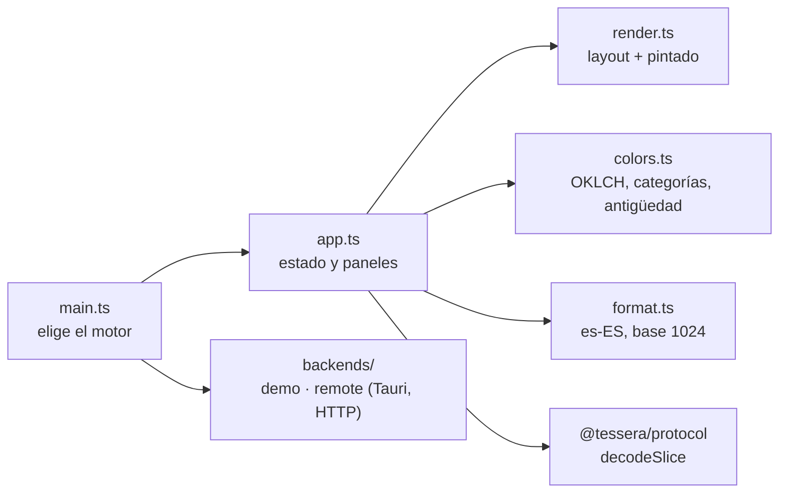
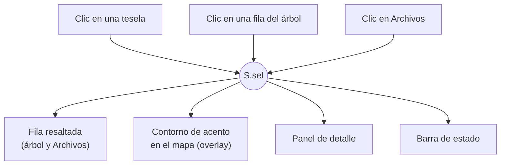
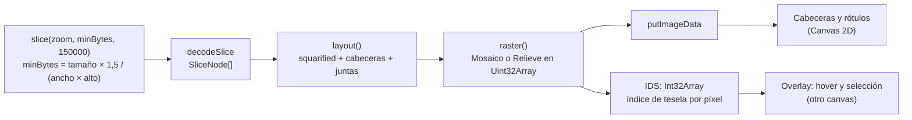
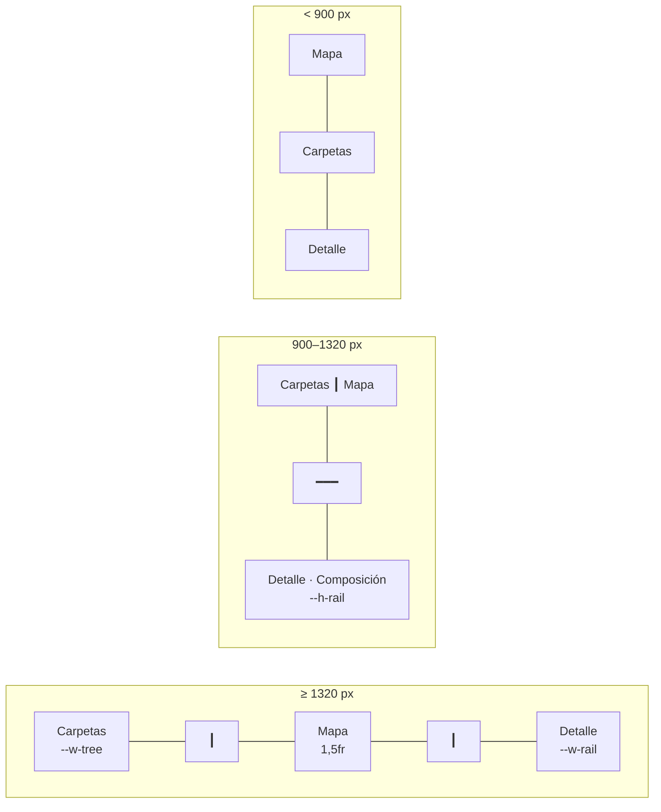

# Interfaz y renderizado

La interfaz es un único HTML autocontenido (≈470 KB con fuentes) que funciona igual en Tauri, en Edge y en un navegador cualquiera (demo). Está escrita en TypeScript sin frameworks y pinta el mapa en un `<canvas>`.



`main.ts` decide el motor según el entorno: `window.__TAURI__` → Tauri; `window.__TESSERA__` (inyectado por el servidor portable) → HTTP; ninguno → demo.

## Una sola selección

Todo el estado vive en un objeto `S` dentro de `app.ts`. La selección (`S.sel`) es lo que une las tres zonas:



Ubicar en el árbol (`locate`) despliega los antepasados, carga las páginas necesarias de `children` hasta encontrar la fila y la desplaza al centro.

## Del slice a los píxeles



El trabajo de pintado depende de los **píxeles de pantalla**, no del número de archivos. Se mide en 50–150 ms por cada 2 M píxeles: un mapa de 900×800 px a resolución doble tiene 2,9 M.

### Layout squarified

Cada carpeta reparte su rectángulo entre sus hijos (ordenados de mayor a menor) por filas. Un hijo se añade a la fila actual mientras no empeore la peor relación de aspecto (Bruls, Huizing y van Wijk, 2000):

```math
\text{worst}(R, w) = \max\left(\frac{w^2 \, r^{+}}{s^2},\ \frac{s^2}{w^2 \, r^{-}}\right)
```

donde $w$ es el lado corto disponible, $s$ la suma de áreas de la fila y $r^{+}$, $r^{-}$ su área mayor y menor. Así las teselas quedan casi cuadradas y el tamaño se compara a simple vista.

Además del algoritmo clásico, TesseraFS:
- reserva una **cabecera de 16 px** para las carpetas de profundidad 1–3 que midan al menos 76×46 px;
- en estilo Mosaico, deja **juntas** de 3, 2 o 1 px según la profundidad, para que se vea la estructura;
- añade la parte podada de cada carpeta (`restSize`) como una **tesela rayada** más, colocada por su tamaño.

### Estilo Mosaico

Cada tesela es plana, con un degradado vertical suave y un bisel de un píxel:

| Píxel | Factor de brillo |
|---|---|
| Base (degradado de arriba abajo) | $1{,}07 - 0{,}15 \cdot t$, con $t \in [0, 1]$ |
| Borde superior o izquierdo | × 1,20 |
| Borde inferior o derecho | × 0,78 |
| Rayado de las teselas «resto» | × 1,18 cada 7 px en diagonal |

Entre teselas se deja un píxel CSS de junta, que se pinta con el color de fondo del tema.

### Estilo Relieve (cushion treemap)

Implementa los *cushion treemaps* de van Wijk y van de Wetering (1999). Cada nivel añade una «cresta» parabólica a la superficie del rectángulo, y el sombreado de cada píxel sale de la normal de esa superficie.

```math
z(x, y) = a\,x^2 + b\,y^2 + c\,x + d\,y
```

Al bajar un nivel, el rectángulo $[x_1, x_2]$ con altura de cresta $h$ actualiza los coeficientes (igual en el eje $y$):

```math
a \mathrel{-}= \frac{4h}{x_2 - x_1}, \qquad c \mathrel{+}= \frac{4h\,(x_1 + x_2)}{x_2 - x_1}, \qquad h_{\text{hijo}} = F \cdot h
```

La intensidad sigue el modelo de Lambert con luz ambiente:

```math
\vec n = \left(-(2ax + c),\ -(2by + d),\ 1\right), \qquad I = \left(I_a + (1 - I_a)\max\left(0, \frac{\vec n \cdot \vec L}{|\vec n|\,|\vec L|}\right)\right) \cdot G
```

con $h = 0{,}32$, $F = 0{,}86$, $I_a = 0{,}16$, $G = 1{,}3$ y luz $\vec L = (-1, -1, 10)$. Si un canal de color supera 255, el exceso se reparte entre los otros dos, lo que da brillos que tienden al blanco.

## Selección y hover sin preguntar al motor

`raster()` rellena un búfer `IDS` del tamaño del canvas con el índice de la tesela de cada píxel:

| Valor | Significa |
|---|---|
| ≥ 0 | Tesela número *n* del layout |
| −1 | Junta (nada) |
| ≤ −2 | Cabecera de carpeta número −2 − valor |

Saber qué hay bajo el puntero es una lectura de un arreglo: O(1). El hover y la selección se dibujan en **otro canvas superpuesto**, así que mover el ratón nunca obliga a repintar el mapa.

### Zoom animado

Al entrar en una carpeta se copia el canvas actual a un tercero (`#snap`) y se le aplica una transformación CSS que amplía el rectángulo de destino hasta llenar el área en 260 ms. Mientras tanto se pide el nuevo slice; al tenerlo, se pinta y la copia se desvanece. Para salir se hace lo contrario: la copia se encoge hasta el rectángulo que ocupa la carpeta anterior en el nuevo mapa.

## Árbol y listas

- **Lista virtual** (`VList`): filas de 26 px y sólo se crean las visibles más 6 por encima y por debajo. Un árbol con miles de filas desplegadas cuesta lo mismo que uno pequeño.
- **Páginas de 500 hijos**: se piden a `children` bajo demanda; la fila «Mostrar 500 más» carga la siguiente.
- **Sangría adaptativa**:

  ```math
  \text{sangría}(d) = \begin{cases} 14\,d & d \le 4 \\ 56 + 7\,(d - 4) & d > 4 \end{cases}
  ```

- **Recorte por el medio**: tras pintar las filas, `fitTexts` mide con `measureText` y busca por bisección cuántos caracteres caben. Conserva la extensión en los nombres y el final en las rutas: `VT_Di…mo.cok`, `C:\Program…\Game`. Si no caben al menos 4 caracteres, deja el recorte normal del CSS.
- **Barra de proporción**: un `<span>` absoluto bajo el nombre, con ancho `calc((100% − sangría) × pct)`.

## Color

Todos los tonos se generan en **OKLCH con la misma luminosidad** ($L = 0{,}72$, $C \approx 0{,}14$). Así ningún color «pesa» más que otro y el relieve no se confunde con el color.

| Modo | Paleta |
|---|---|
| Categoría | 10 categorías con tono fijo (Vídeo 28°, Imágenes 342°, Audio 305°, Documentos 88°, Código 145°, Compilación 178°, Aplicaciones 252°, Comprimidos 58°, Juegos 205°, Datos y modelos 280°) y gris neutro para «Otros». Los nombres salen del catálogo (`cat.<id>`) |
| Extensión | 16 tonos repartidos para las 16 extensiones con más bytes del escaneo; el resto, gris |
| Antigüedad | 5 tramos de ámbar (reciente) a índigo (más de 3 años) |

Al resaltar algo, lo demás se apaga en gris: luminancia × 0,32 en tema oscuro y $200 + 0{,}16 \cdot L$ en tema claro. Los colores de datos no cambian entre temas; sólo cambian el fondo, las juntas y las cabeceras.

## Tarjeta de progreso

- Se construye una sola vez y después sólo cambian sus textos. Las cifras usan dígitos tabulares y anchos fijos, así que nada se desplaza.
- Porcentaje: `fraction` si el motor la envía; si no, bytes leídos ÷ (capacidad − libre) de la unidad, con un máximo del 99 % hasta las fases finales; en carpetas sueltas, modo indeterminado.
- El mosaico de 96 teselas se enciende en un orden pseudoaleatorio fijo según avanza el porcentaje.
- La cabecera muestra un texto compacto («Escaneando · 47 %») de ancho fijo, para no empujar el filtro a otra línea.

## Distribución en pantalla



- Los divisores son elementos `role="separator"` que cambian las variables CSS `--w-tree`, `--w-rail` y `--h-rail`. Se guardan en `localStorage`.
- Durante el arrastre, el mapa se repinta a resolución 1:1 en cada fotograma; al soltar, se pide de nuevo el slice a resolución completa.
- Las columnas del árbol se adaptan con *container queries* según el ancho del propio panel (700, 520 y 340 px), no el de la ventana.

## Accesibilidad

- Todo se puede hacer con teclado: flechas en el árbol, Intro, Retroceso, 1/2/3, Supr y Esc. Los divisores también responden a flechas e Inicio.
- Roles ARIA: `treegrid`, `row`, `tab`, `menu`, `separator` y `status` (en el progreso).
- Foco visible en todos los controles.
- Con `prefers-reduced-motion` se desactivan todas las transiciones y animaciones.

## Construcción

`packages/ui/build.ts`:
1. Empaqueta `src/main.ts` con `Bun.build` (IIFE minificado) e inyecta `__TESSERA_VERSION__` desde `package.json`.
2. Incrusta las fuentes (`fonts/*.woff2`) como data URI y el CSS en línea.
3. Escribe `dist/index.html`, el documento completo que usan Tauri y la portable, y `dist-demo/demo.html`, sólo el contenido, para publicar la demo.

La interfaz resultante no hace **ninguna** petición externa. Los catálogos de idiomas van dentro del mismo HTML (≈100 KB sin comprimir los cinco), así que el cambio de idioma es instantáneo y funciona sin conexión.

## Idiomas

Todos los textos, cifras y fechas pasan por `src/i18n.ts` y `@tessera/i18n`: el HTML lleva atributos `data-i18n` y el código usa `t()`. Al cambiar de idioma se vuelve a pintar sin perder el estado. Diseño completo en [Internacionalización](i18n.md).
