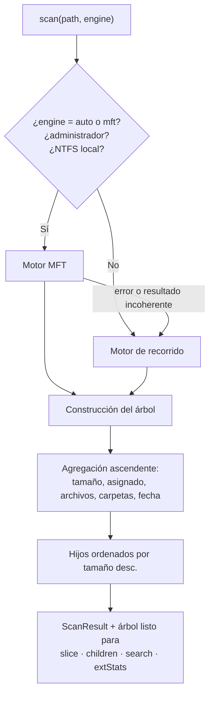
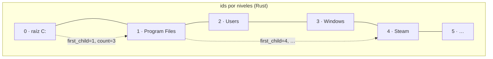
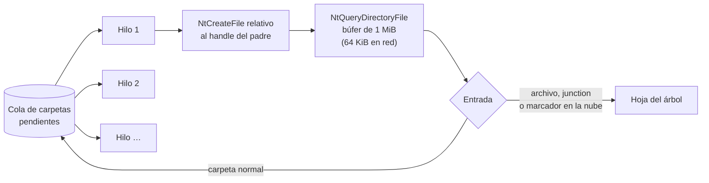
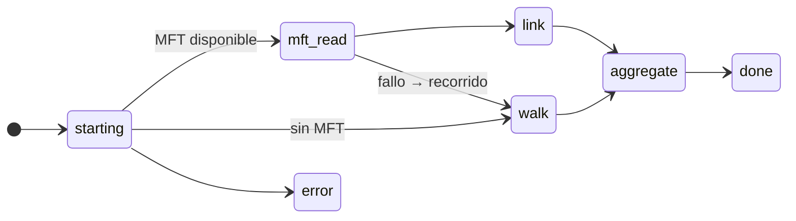
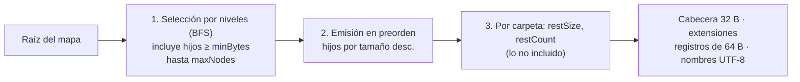

# Motores de escaneo

Los dos motores (Rust en `crates/tessera-core` y TypeScript en `packages/core-bun`) hacen lo mismo con las mismas reglas: eligen cómo leer el disco, construyen un árbol compacto y responden a las operaciones del [contrato](../ARQUITECTURA.md).

Si el modo MFT no está disponible o falla, el motor recorre las carpetas y lo indica en `warnings` (por ejemplo: «MFT no disponible sin administrador: se usó el recorrido»).

## Modelo de datos: árbol en arreglos (SoA)

En vez de un objeto por archivo, el árbol se guarda como **columnas**: un arreglo por campo, indexado por id.

| Columna | Tipo | Notas |
|---|---|---|
| `parent` | u32 | Rust: los ids siguen el orden por niveles, así que el padre siempre es menor que sus hijos |
| `first_child` · `child_count` | u32 | Rust: los hijos de cada carpeta son **contiguos** y ya están ordenados por tamaño |
| `size` · `alloc` | u64 (Rust) / f64 (Bun) | Tamaño lógico y espacio asignado |
| `files` · `dirs` | u32 | Descendientes |
| `mtime` | u32 | Segundos Unix |
| `ext` | u16 | Índice en una tabla de extensiones internadas |
| `flags` | u16 | `DIR HIDDEN SYSTEM HARDLINK COMPRESSED REPARSE CLOUD SPARSE` |
| nombre | desplazamiento + longitud | Un único búfer: WTF-8 en Rust (admite UTF-16 mal formado), UTF-16 sin decodificar en Bun |

En Rust ocupa unos **50 bytes por nodo más los nombres**: 107 MiB para 1,47 M nodos, de los que 38,5 MB son nombres.

La **agregación** es una sola pasada en orden inverso de ids: cada nodo suma lo suyo a su padre. Como el padre siempre tiene un id menor, al llegar a él ya está completo.

## Reglas comunes

| Situación | Regla |
|---|---|
| Enlaces duros | El primer nombre conserva tamaño y asignado. Los demás llevan `HARDLINK` con 0 bytes, de modo que cada carpeta suma exactamente lo de sus hijos. En el recorrido se detectan por el id de archivo de NTFS. |
| Junctions y symlinks | Hojas con `REPARSE`; nunca se siguen, así que no hay bucles ni doble conteo |
| OneDrive y similares | Las carpetas se recorren. Los marcadores sólo en la nube llevan `CLOUD` y **nunca se abren**, porque abrirlos los descargaría. |
| Acceso denegado | La carpeta se omite y se suma a un aviso; el escaneo continúa |
| Raíz | Se llama con su ruta (`C:\`) y `parentId = -1`. `entries` = archivos + carpetas, sin contar la raíz. |
| Metadatos NTFS (`$MFT`, `$LogFile`…) | En modo MFT aparecen en la raíz como ocultos y de sistema, porque ocupan espacio real |
| Papelera | Tras `action("trash")` con éxito, el nodo se quita del árbol y se descuenta de todos sus antepasados |

## Motor MFT

La **Master File Table** de NTFS contiene un registro de 1 KiB (normalmente) por cada archivo y carpeta del volumen. Leerla entera de forma secuencial es mucho más rápido que preguntar a Windows carpeta por carpeta.

```mermaid
flowchart LR
    A["CreateFileW(\\.\C:)<br/>sólo lectura, sin búfer"] --> B["FSCTL_GET_NTFS_VOLUME_DATA<br/>clúster · tamaño de registro · MftValidDataLength"]
    B --> C["Extents de la MFT<br/>FSCTL_GET_RETRIEVAL_POINTERS<br/>o runlist del registro 0"]
    C --> D["Lecturas alineadas de 4 MiB<br/>Rust: 8 lectores en paralelo"]
    D --> E["Fixups<br/>(update sequence array)"]
    E --> F["Atributos:<br/>$STANDARD_INFORMATION<br/>$FILE_NAME · $DATA<br/>$REPARSE_POINT"]
    F --> G["Fusión de registros<br/>de extensión"]
    G --> H["Enlace por referencia<br/>al padre"]
    H --> I["Árbol"]
```

Cada registro pasa por estos pasos:
1. **Fixups.** Los dos últimos bytes de cada sector de 512 B se guardan aparte en el *update sequence array*. Se comprueban y se restauran; si no cuadran, el registro está dañado y se descarta.
2. **En uso.** Los registros libres se saltan.
3. **`$FILE_NAME`.** Puede haber varios. Se ignora el espacio de nombres DOS (8.3) y cada nombre restante aporta un padre. Varios nombres con padres distintos son un enlace duro.
4. **`$DATA` sin nombre.** El tamaño y el asignado salen del atributo residente o no residente. En los comprimidos o dispersos se usa el campo de tamaño comprimido. En los archivos con compresión WOF (CompactOS), el asignado sale del flujo `WofCompressedData`.
5. **Registros de extensión.** Cuando un archivo no cabe en un registro, sus atributos siguen en otros que apuntan a su registro base. Se fusionan con él, aunque aparezcan antes. Sólo cuenta el fragmento de `$DATA` con VCN inicial 0, para no sumar dos veces.

| | Rust | Bun |
|---|---|---|
| Lectura | 8 hilos con su propio handle y búfer alineado; el parseo se hace en el mismo hilo que leyó | Un hilo, secuencial, cediendo el bucle de eventos cada 30 ms |
| C:\ con 1,5 M registros | **1,8 s** | 9,3 s |
| Progreso | `fraction` = bytes de la MFT leídos ÷ total | Igual |

> [!NOTE]
> Es una implementación propia a partir de documentación pública (Linux-NTFS, libyal, MS-FSCC); no deriva de código GPL. El parser se prueba con registros sintéticos: fixups correctos y dañados, nombres DOS, registros borrados, extensiones fuera de orden, enlaces duros, compresión, WOF, junctions y huérfanos.

## Motor de recorrido

Funciona sin administrador y con cualquier sistema de archivos. La clave es usar **`NtQueryDirectoryFile`** en lugar de `FindFirstFile`: una sola llamada devuelve por entrada el tamaño, el asignado, los atributos, la etiqueta de *reparse* y el id de archivo.

| | Rust | Bun |
|---|---|---|
| Paralelismo | Robo de trabajo con rayon: un hilo por núcleo lógico | *Workers* persistentes: la mitad de los núcleos, entre 2 y 8. Nunca se terminan, porque `worker.terminate()` cuelga Bun 1.3 en Windows. |
| Clases de información | `FileIdExtdDirectoryInformation`, con caída a `FileIdFullDirectoryInformation` (38) y `FileFullDirectoryInformation` (2) | La misma cadena |
| Archivos comprimidos al vuelo (`compact /exe`) | El listado da 0 bytes asignados, así que se consulta el asignado real leyendo sólo atributos | — |
| C:\ con 1,47 M elementos | **4,2–5,1 s** (16 hilos) | 4,7–5,8 s (8 workers) |

El coste está en el núcleo de Windows y en los filtros del antivirus: abrir una carpeta cuesta unos 100 µs, cada consulta 25 µs y cerrarla 40 µs. Por eso el paralelismo importa más que el lenguaje.

## Progreso

Cada evento `ScanProgress` lleva la fase, los elementos, los bytes, el tiempo, un detalle (la ruta actual) y, cuando se conoce, `fraction` entre 0 y 1. Sin `fraction`, la interfaz estima el avance con los bytes leídos frente al espacio usado de la unidad.

## Búsqueda y estadísticas

- La consulta se compila una vez (`compileQuery` en TS, `query.rs` en Rust) a una lista de grupos O de condiciones Y.
- Se recorre el subárbol de `root` manteniendo los `limit` mayores (top-k por tamaño), mientras se cuentan el total y los bytes de **todas** las coincidencias.
- La ruta completa sólo se construye si la consulta usa `path:` o si la fila entra en el resultado.
- 80–140 ms (Rust) y 140–300 ms (Bun) sobre 1,46 M nodos.

Las 21 consultas de la prueba cruzada (`crates/tessera-cli/tests/crosscheck.ts`) dan los mismos totales, bytes, orden y rutas en Rust y en TypeScript.

## Slice: el subárbol para el mapa

La selección por niveles gasta el presupuesto primero en lo que más se ve. El resultado es **idéntico byte a byte** en Rust y en TypeScript; la prueba cruzada recodifica el mismo árbol en ambos y compara los 397.575 bytes.

## Memoria

| Motor | Árbol de 1,47 M nodos | Pico durante el escaneo |
|---|---|---|
| Rust | ≈107 MiB | ≈270 MiB |
| Bun | ≈525 MB tras el escaneo | ≈800–900 MB (incluye 25–40 MB por *worker*) |

## Pendiente

- Saltar los registros libres con `$MFT:$BITMAP` (≈40 % menos de E/S).
- Lectura de la MFT con E/S solapada y varios hilos en Bun.
- Actualización en vivo con el diario USN (`FSCTL_READ_USN_JOURNAL`), sin volver a escanear.
- Cancelar un escaneo desde la interfaz.
- Proceso auxiliar elevado y mínimo, en lugar de relanzar la app completa.
