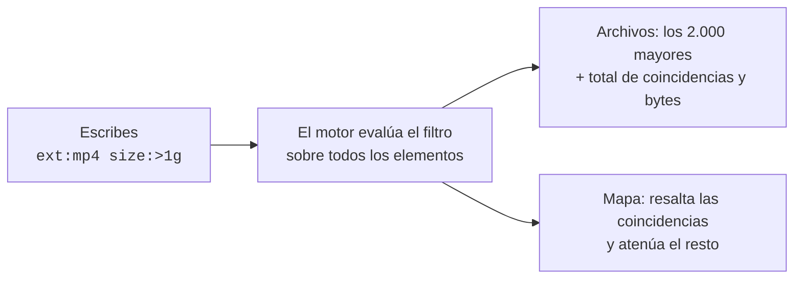

# Filtros

El campo **Filtrar** (atajo **Ctrl K**) busca en todo lo escaneado. Los resultados aparecen en la pestaña **Archivos**, ordenados de mayor a menor, y el mapa atenúa todo lo que no coincide.

## Reglas básicas

| Escribes | Significa |
|---|---|
| `foto` | Nombres que **contienen** «foto» (sin distinguir mayúsculas) |
| `IMG_*.jpg` | Comodines sobre el nombre completo: `*` cualquier texto, `?` un carácter |
| `a b` | **a y b**: el espacio exige que se cumplan las dos |
| `a OR b` · `a \| b` | **a o b** |
| `-a` | **No** a: excluye lo que cumpla `a` |
| `"Cities Skylines"` | Comillas para textos con espacios, también tras una clave: `name:"System Volume Information"` |

Sin la clave `type:`, el filtro sólo devuelve **archivos**. Para incluir carpetas, añade `type:dir`.

## Claves

| Clave (alias en español) | Ejemplos | Qué filtra |
|---|---|---|
| `ext:` | `ext:mp4` · `ext:jpg,png,heic` · `ext:none` | Extensión, sin punto. Varias separadas por comas; `none` = sin extensión |
| `size:` (`tam:`) | `size:>1g` · `size:<10k` · `size:100m..2g` | Tamaño lógico |
| `alloc:` (`asig:`) | `alloc:>500m` | Espacio realmente ocupado en disco |
| `age:` (`edad:`) | `age:<7d` · `age:>1y` · `age:30d..6mo` | Tiempo desde la última modificación |
| `path:` (`ruta:`) | `path:Downloads` · `path:steamapps` | Texto en cualquier parte de la ruta completa |
| `name:` (`nombre:`) | `name:backup` · `name:*.bak` | Texto o comodín sobre el nombre |
| `re:` | `re:^IMG_\d{4}` | Expresión regular sobre el nombre |
| `type:` (`tipo:`) | `type:dir` · `tipo:carpeta` · `type:file` | Carpetas o archivos |
| `files:` (`archivos:`) | `type:dir files:=0` · `type:dir files:>10k` · `files:10..1k` | Archivos que hay dentro de una carpeta, contando subcarpetas (en un archivo, 0). Sin operador significa «al menos»: para «exactamente», `=`. `k` = mil, `m` = millón |
| `attr:` (`atrib:`) | `attr:cloud` · `atrib:oculto,sistema` · `attr:compressed` | Atributos: `cloud` (OneDrive y similares), `hidden`, `system`, `compressed`, `hardlink`, `sparse`, `reparse`; en español `nube`, `oculto`, `sistema`, `comprimido`, `enlace`, `disperso`, `reanalisis`. Varios con comas = cualquiera |

**Unidades de tamaño** (base 1024, como en Windows): `b`, `k`, `m`, `g`, `t`. `1g` = 1.073.741.824 bytes.

**Unidades de tiempo:** `d` días, `w` semanas, `mo` meses (30 días), `y` años (365 días).

**Comparadores:** `>`, `>=`, `<`, `<=`, `=` y rangos `a..b`. Sin comparador, `size:1g` significa «al menos 1 GB».

> [!NOTE]
> `age:<30d` significa «modificado **hace menos de** 30 días» (reciente). `age:>1y` significa «modificado hace **más de** un año» (antiguo).

## Recetario

| Para encontrar | Escribe |
|---|---|
| Vídeos de más de 1 GB | `ext:mp4,mkv,mov,avi size:>1g` |
| Lo grande que nadie toca desde hace 2 años | `age:>2y size:>500m` |
| Instaladores olvidados en Descargas | `path:Downloads ext:msi,exe,iso,zip` |
| Modelos de IA locales | `ext:gguf,safetensors,ckpt,onnx` |
| Carpetas de dependencias de Node | `type:dir name:node_modules` |
| Compilaciones de Rust | `type:dir name:target` |
| Archivos de OneDrive descargados en este equipo | `attr:cloud alloc:>0` |
| Lo que ya está comprimido | `attr:compressed` |
| Entornos virtuales de Python | `type:dir name:.venv` |
| Discos virtuales (WSL, Docker, Hyper-V) | `ext:vhdx,vhd` |
| Copias de seguridad sueltas | `ext:bak,old,tmp size:>50m` |
| Carpetas vacías (sin contar enlaces ni puntos de montaje) | `type:dir files:=0 -attr:reparse` |
| Archivos vacíos | `size:=0` |
| Carpetas con muchísimos archivos pequeños | `type:dir files:>10k size:<500m` |
| Cachés que se declaran como tales | `re:^CACHEDIR\.TAG$` (la carpeta que lo contiene es la caché) |
| Registros enormes | `ext:log size:>200m` |
| Fotos del móvil | `IMG_*.jpg OR IMG_*.heic` |
| Todo lo de un proyecto menos su `.git` | `path:mi-proyecto -path:.git` |
| Archivos grandes que no son del sistema | `size:>1g -path:Windows -ext:sys` |
| Archivos comprimidos que ocupan poco en disco | `size:>1g alloc:<500m` |
| Lo creado o cambiado esta semana | `age:<7d size:>10m` |

> [!TIP]
> Después de filtrar, cambia el color del mapa a **Antigüedad** (tecla **3**). Verás de un vistazo si lo que encontraste es reciente o lleva años olvidado.

## Detalles

- **Rendimiento:** el filtro se evalúa dentro del motor, no en la interfaz. Sobre 1,5 millones de elementos tarda entre 80 y 300 ms.
- **Resultados:** se listan los 2.000 mayores, pero el contador y los bytes totales cuentan **todas** las coincidencias.
- **Expresiones regulares:**
  - En la edición de escritorio siguen la sintaxis de Rust: sin *lookahead* ni *backreferences*.
  - En la portable siguen la de JavaScript.
  - Lo básico (`^`, `$`, `\d`, `[…]`, `(a|b)`, `*`, `+`, `?`, `{n}`) funciona igual en ambas.
- **Errores:** si el filtro no es válido (por ejemplo, `size:>abc`), Archivos te dice por qué en lugar de mostrar resultados.
- **Quitar el filtro:** borra el texto, pulsa **Esc** o la ✕ de la pastilla de resaltado del mapa.
