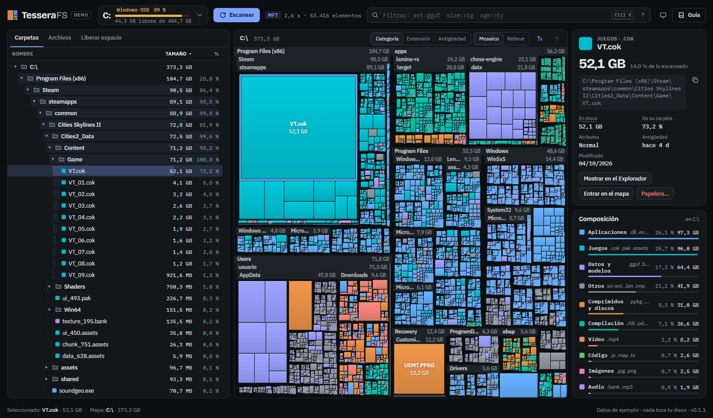
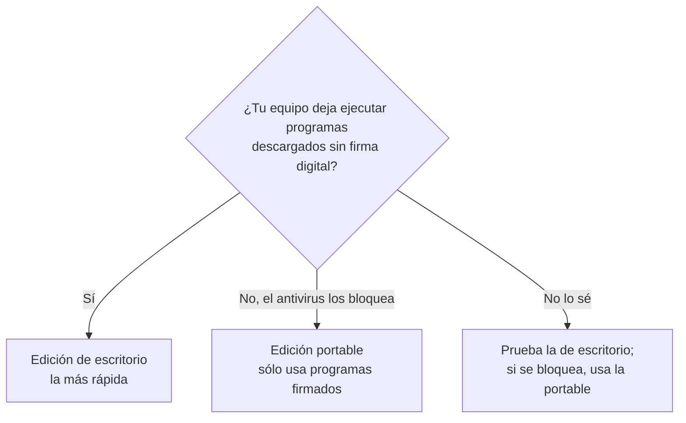
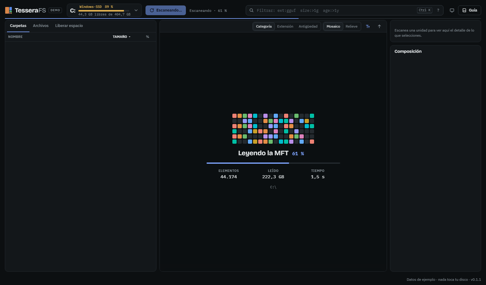
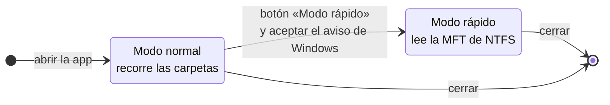
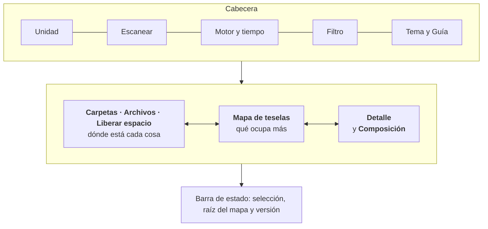
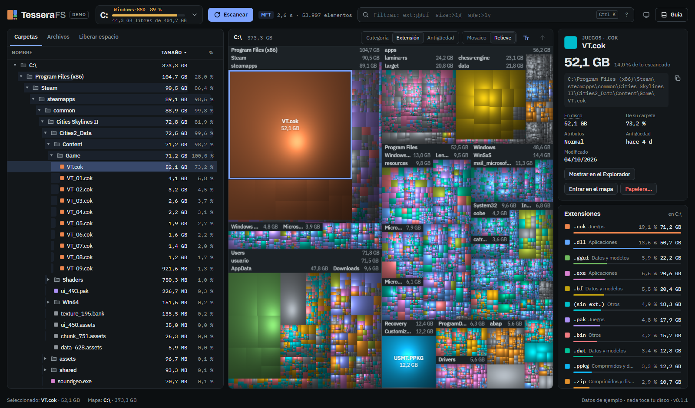
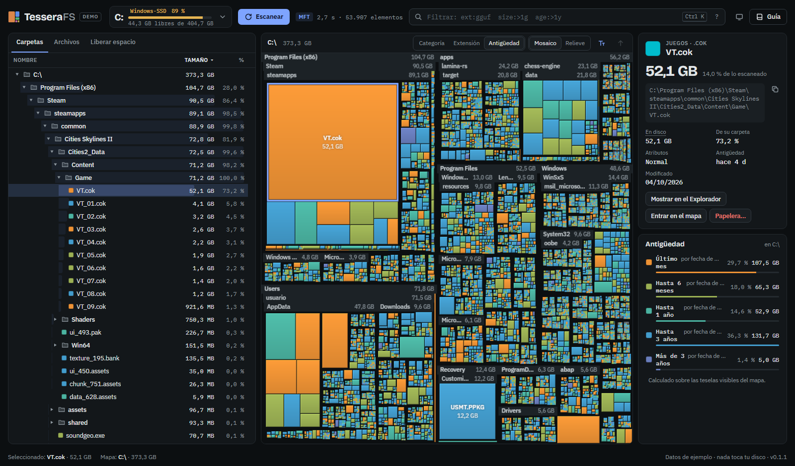
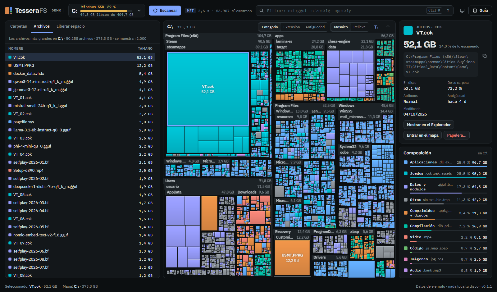
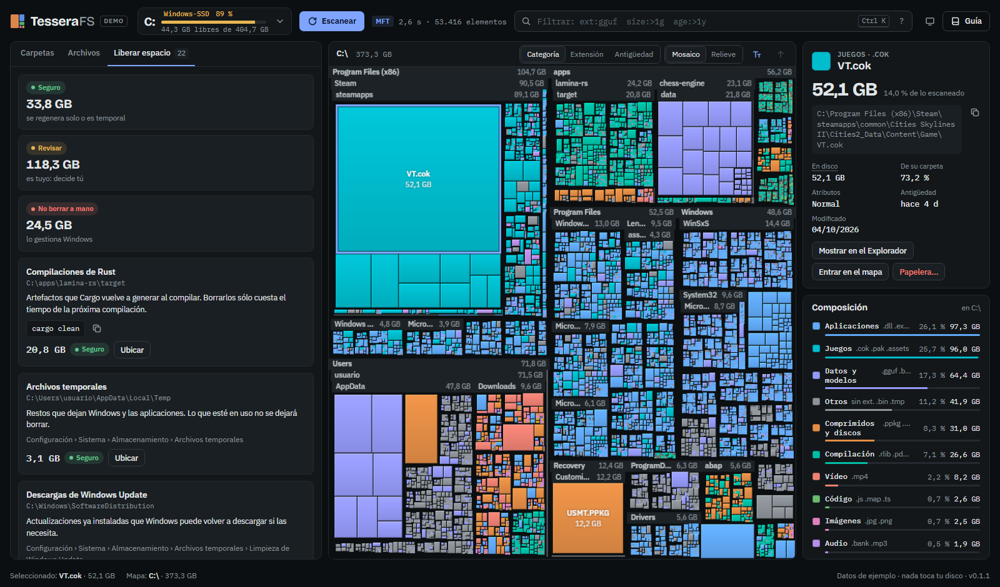

# Guía de usuario

TesseraFS te muestra **qué ocupa tu disco** en unos segundos. Dibuja la unidad como un mosaico: cada tesela es un archivo, su área es su tamaño y las carpetas agrupan sus teselas bajo una cabecera. Con un clic sabes qué es una tesela y dónde está; con otro, la tienes ubicada en el árbol de carpetas.



> [!NOTE]
> Todas las capturas de esta guía usan **datos de ejemplo** de la edición demo. Nada de lo que ves es el disco de una persona real.

## Contenido

1. [Elegir edición](#1-elegir-edición)
2. [Primer escaneo](#2-primer-escaneo)
3. [La pantalla de un vistazo](#3-la-pantalla-de-un-vistazo)
4. [Leer el mapa](#4-leer-el-mapa)
5. [Colores: categoría, extensión y antigüedad](#5-colores-categoría-extensión-y-antigüedad)
6. [Panel Carpetas](#6-panel-carpetas)
7. [Panel Archivos](#7-panel-archivos)
8. [Panel de detalle y acciones](#8-panel-de-detalle-y-acciones)
9. [Filtrar](#9-filtrar)
10. [Liberar espacio](#10-liberar-espacio)
11. [Atajos de teclado](#11-atajos-de-teclado)
12. [Personalizar](#12-personalizar)
13. [Privacidad y seguridad](#13-privacidad-y-seguridad)
14. [Trucos](#14-trucos)

---

## 1. Elegir edición

TesseraFS tiene dos ediciones con **la misma interfaz y los mismos resultados**. Cambia cómo se ejecuta.

| | Escritorio | Portable |
|---|---|---|
| Qué es | Un único `tesserafs-desktop.exe` (≈11 MB) | Una carpeta con `bun.exe`, `tesserafs.js` y un lanzador (≈94 MB) |
| Ventana | Propia (WebView2) | Una ventana de aplicación de Microsoft Edge |
| Velocidad en C:\ con 1,5 M elementos | **1,8 s** con administrador · 4–5 s sin él | 9 s con administrador · 5–6 s sin él |
| Instalación | Ninguna: se copia y se ejecuta | Ninguna: se copia la carpeta |
| Ideal para | Tu propio equipo | Equipos de empresa donde el antivirus bloquea ejecutables sin firma |



> [!TIP]
> La edición portable no lleva ningún ejecutable propio. Sólo usa `bun.exe`, firmado por su editor, y Edge, que ya viene con Windows. Por eso suele funcionar donde el antivirus corporativo bloquea otros programas.

### Descargar

Cada versión se publica en la página **Releases** del repositorio con dos zips:

| Archivo | Edición |
|---|---|
| `TesseraFS-X.Y.Z-escritorio-win-x64.zip` (≈3,5 MB) | Escritorio |
| `TesseraFS-X.Y.Z-portable-win-x64.zip` (≈37 MB) | Portable |
| `SHA256SUMS.txt` | Sumas para comprobar que la descarga está íntegra |

1. Descarga el zip de tu edición.
2. **Desbloquéalo antes de descomprimir:** clic derecho › Propiedades › marca **Desbloquear** › Aceptar. Windows marca todo lo descargado de internet y, sin este paso, cada archivo extraído hereda la marca: más avisos al abrirlo.
3. Clic derecho › **Extraer todo…** en la carpeta que prefieras.

> [!TIP]
> Para comprobar que el zip no se ha dañado ni modificado, compara su suma con la de `SHA256SUMS.txt`:
> ```powershell
> Get-FileHash .\TesseraFS-0.2.0-portable-win-x64.zip
> ```

### Escritorio

1. Copia `tesserafs-desktop.exe` donde quieras (por ejemplo, `C:\Herramientas`).
2. Ábrelo con doble clic. Si Windows muestra *"Windows protegió su PC"*, pulsa **Más información › Ejecutar de todas formas**: el ejecutable aún no está firmado.
3. Necesita WebView2, que viene de serie en Windows 11 y en Windows 10 actualizado.

### Portable

1. Copia la carpeta `TesseraFS-portable` completa (a un USB, a tu carpeta de usuario…).
2. Ejecuta **`TesseraFS.cmd`**. Se abre una ventana de aplicación de Edge sin consola visible.
3. Al cerrar la ventana, TesseraFS termina solo en menos de un segundo. Tus otras ventanas de Edge no se tocan.

`TesseraFS.vbs` hace lo mismo sin el parpadeo de consola. Microsoft está retirando VBScript y muchas empresas lo bloquean, así que el `.cmd` es la opción recomendada.

---

## 2. Primer escaneo

Al abrir la app, la pantalla de inicio muestra **todas las unidades** con su uso y su espacio libre; la barra se vuelve ámbar por encima del 85 %. Pulsa una para escanearla, o escribe abajo la ruta de una carpeta y pulsa **Analizar**.

También puedes elegir la unidad en el selector de la cabecera y pulsar **Escanear**.



Mientras escanea, la tarjeta central muestra la fase, el porcentaje, los elementos encontrados, los datos leídos y el tiempo. El mosaico se llena con el **progreso real**.

**Cancelar:** durante el escaneo, el botón Escanear pasa a **Cancelar** (también vale **Esc** o el botón de la tarjeta). Si ya tenías un escaneo anterior y el motor lo conserva, se vuelve a él; si no, vuelves a la pantalla de unidades.

### Modo rápido (con administrador) y modo normal

TesseraFS tiene dos formas de leer el disco y elige sola la mejor posible:



| | Modo normal | Modo rápido |
|---|---|---|
| Permisos | Los de tu usuario | Administrador |
| Cómo lee | Carpeta a carpeta | La tabla maestra de archivos (MFT) de una vez |
| Velocidad típica (1,5 M elementos) | 4–6 s | 1,8 s (escritorio) |
| Ve las carpetas protegidas | No, las omite y avisa | Sí |
| Unidades | Cualquiera: NTFS, FAT, exFAT, red | Sólo NTFS locales |

La pastilla junto al botón Escanear indica qué modo se usó: **MFT** o **Recorrido**.

> [!IMPORTANT]
> El modo rápido sólo **lee**. TesseraFS nunca escribe en el volumen ni en la MFT; necesita permisos de administrador únicamente porque Windows reserva a los administradores la lectura directa del disco.

### Analizar una carpeta

En el selector de unidad, escribe una ruta en **Analizar una carpeta** (por ejemplo, `C:\Users\tu-usuario\Downloads`) y pulsa **Analizar**. Con permisos de administrador, la edición de escritorio también usa la MFT para carpetas sueltas; la portable las recorre siempre en modo normal.

---

## 3. La pantalla de un vistazo



Las tres zonas están **enlazadas por una única selección**: lo que eliges en una se marca en las otras dos. Puedes ajustar su ancho con los divisores (ver [Personalizar](#12-personalizar)).

---

## 4. Leer el mapa

| Lo que ves | Qué significa |
|---|---|
| Área de una tesela | El tamaño del archivo. El doble de área es el doble de espacio. |
| Cabecera con nombre y tamaño | Una carpeta; sus teselas están debajo |
| Juntas entre teselas | Separan carpetas y archivos, como en un mosaico |
| Tesela gris rayada | Muchos archivos pequeños de esa carpeta agrupados (pasa el puntero para ver cuántos) |
| Contorno de color de acento | El elemento seleccionado |
| Contorno blanco y discontinuo | La tesela bajo el puntero y su carpeta |
| Nombre en el centro | Archivos lo bastante grandes como para rotularlos |

**Con el ratón:**
- **Pasar el puntero:** nombre, ruta, tamaño, porcentaje del mapa, tipo y antigüedad.
- **Clic:** ubica el elemento en el panel **Carpetas**, que se despliega y desplaza hasta la fila.
- **Doble clic:** entra en la carpeta, con una transición de zoom.
- **Clic derecho:** abrir, mostrar en el Explorador, copiar ruta, entrar, ubicar, propiedades o papelera.

**Para volver atrás:** pulsa una carpeta de las migas de pan (`C:\ › apps › proyecto`), el botón **↑** o la tecla **Retroceso**.

**Estilos:**
- **Mosaico** (por defecto): teselas planas con juntas y cabeceras; lo más legible.
- **Relieve**: sombreado tridimensional; cada archivo parece un cojín y los grupos se distinguen por su forma.

El botón **T** muestra u oculta cabeceras y nombres.



> [!TIP]
> Las teselas más pequeñas que un par de píxeles no se dibujan una a una: se agrupan en la tesela rayada de su carpeta. Haz doble clic en ella para entrar en la carpeta y verlas.

---

## 5. Colores: categoría, extensión y antigüedad

Elige el color con los botones del mapa o con las teclas **1**, **2** y **3**. El panel **Composición** cambia a la vez.

| Modo | Para qué sirve |
|---|---|
| **Categoría** (1) | Ver de un vistazo qué *tipo* de contenido domina: juegos, vídeos, compilaciones… |
| **Extensión** (2) | Las 16 extensiones que más ocupan tienen color propio; el resto, gris |
| **Antigüedad** (3) | Encontrar lo que lleva años sin modificarse |

Categorías y algunos ejemplos de extensión:

| Categoría | Extensiones típicas |
|---|---|
| Vídeo | mp4, mkv, mov, avi |
| Imágenes | jpg, png, heic, raw, psd |
| Audio | mp3, wav, flac, bank |
| Documentos | pdf, docx, xlsx, pptx, txt |
| Código | js, ts, py, rs, json, html |
| Compilación | o, obj, lib, rlib, pdb, pyc, jar |
| Aplicaciones | exe, dll, msi, sys, cab |
| Comprimidos y discos | zip, 7z, iso, vhdx, wim |
| Juegos | pak, assets, ress, cok, bsa |
| Datos y modelos | gguf, safetensors, onnx, db, parquet |
| Otros | Sin extensión, temporales, registros… |



En **Antigüedad**, los tramos son: último mes, hasta 6 meses, hasta 1 año, hasta 3 años y más de 3 años. Pulsa un tramo en Composición para resaltar sólo esas teselas.

> [!TIP]
> Combina **Antigüedad** con un filtro: `age:>2y size:>500m` te deja a la vista lo grande que nadie toca desde hace dos años.

---

## 6. Panel Carpetas

| Columna | Significado |
|---|---|
| Nombre | Con su icono: carpeta, o color del archivo según el modo de color |
| Tamaño | Tamaño lógico: lo que ocupa el contenido |
| % | Proporción dentro de su carpeta. La barra de fondo de la fila la muestra de forma visual. |
| En disco | Espacio realmente asignado: puede ser menor si está comprimido o en la nube |
| Elementos | Archivos y carpetas que contiene |
| Modificado | Fecha de la última modificación |

- Pulsa en los encabezados para **ordenar**; vuelve a pulsar para invertir el orden.
- Las carpetas con muchos hijos cargan de 500 en 500: pulsa **Mostrar 500 más** al final de la lista.
- Los nombres largos se recortan **por el medio** y conservan la extensión (`VT_Di…mo.cok`). Al pasar el puntero se ve el nombre completo.
- Las columnas se ocultan solas cuando el panel es estrecho. Ensánchalo con el divisor para verlas todas.
- Los elementos ocultos aparecen atenuados; los **enlaces duros**, en cursiva.

---

## 7. Panel Archivos

Sin filtro, muestra los **archivos más grandes** de la carpeta que tengas abierta en el mapa (hasta 2.000). Con un filtro, muestra sus resultados en todo el escaneo.



- Un clic selecciona el archivo y lo marca en el mapa.
- Un doble clic lo ubica en el panel Carpetas.
- La columna Carpeta se recorta por el medio para que siempre veas la carpeta final.

---

## 8. Panel de detalle y acciones

Arriba a la derecha está todo sobre lo seleccionado: tipo, tamaño, porcentaje del total, ruta completa (con botón de copiar), espacio en disco, proporción dentro de su carpeta, número de archivos y carpetas, atributos y fechas.

| Acción | Qué hace |
|---|---|
| Mostrar en el Explorador | Abre el Explorador con el elemento seleccionado |
| Entrar en el mapa | Hace de esa carpeta la raíz del mapa |
| Papelera… | Pide confirmación en el propio panel y lo mueve a la **Papelera de reciclaje** |

> [!CAUTION]
> TesseraFS nunca borra de forma definitiva. Mover a la papelera siempre pide confirmación y se puede deshacer desde la Papelera de Windows. Aun así, revisa la pestaña [Liberar espacio](liberar-espacio.md) antes de borrar archivos del sistema.

**Composición** (debajo) resume el espacio de la carpeta del mapa por categoría, extensión o antigüedad. Pulsa una fila para resaltar sus teselas, y en modo Categoría verás también sus extensiones principales.

---

## 9. Filtrar

Pulsa **Ctrl K** (o **Ctrl F**) y escribe. Los resultados aparecen en **Archivos** y el mapa atenúa todo lo demás.

```text
ext:gguf,safetensors          modelos de IA
size:>1g                      archivos de más de 1 GB
age:>2y size:>100m            grandes y sin tocar en dos años
path:Downloads ext:msi,exe    instaladores olvidados en Descargas
-ext:dll size:>500m           grandes que no son DLL
```

La referencia completa y un recetario están en **[Filtros](filtros.md)**. El botón **?** junto al campo muestra ejemplos que se aplican con un clic.

---

## 10. Liberar espacio

La pestaña **Liberar espacio** busca candidatos y los clasifica en tres niveles:

| Nivel | Significa |
|---|---|
| 🟢 **Seguro** | Se regenera solo o es temporal: compilaciones, dependencias, temporales |
| 🟡 **Revisar** | Es tuyo y puede que lo quieras: juegos, modelos, discos virtuales, descargas |
| 🔴 **No borrar a mano** | Lo gestiona Windows: paginación, WinSxS, caché de instaladores |

Cada tarjeta explica qué es, cuánto ocupa y cómo liberarlo bien: con la orden adecuada (`cargo clean`, `DISM …`, con botón de copiar) o con el ajuste de Windows correspondiente. Pulsa **Ubicar** para verlo en el árbol y en el mapa.



Detalles y procedimientos seguros en **[Liberar espacio](liberar-espacio.md)**.

---

## 11. Atajos de teclado

| Tecla | Acción |
|---|---|
| **Ctrl K** · **Ctrl F** | Ir al filtro |
| **↑ ↓** | Moverse por el árbol |
| **→ ←** | Expandir o plegar carpeta (o ir al padre) |
| **Intro** | Entrar en la carpeta seleccionada en el mapa |
| **Retroceso** | Subir un nivel en el mapa |
| **1 · 2 · 3** | Color por categoría, extensión o antigüedad |
| **Supr** | Mover a la papelera (pide confirmación) |
| **Esc** | Quitar el resaltado, cancelar la confirmación o cerrar menús |
| Divisor + **← →** / **↑ ↓** | Redimensionar paneles (con **Mayús**, pasos largos) |
| Divisor + **Inicio** | Restablecer el tamaño del panel |

---

## 12. Personalizar

- **Idioma:** el botón del globo, en la cabecera, elige entre automático (el idioma de Windows) y English, Español, Português (Brasil), Français o Deutsch. El cambio es inmediato y no pierde el escaneo; la elección se recuerda.
- **Tema:** el botón de la cabecera alterna entre sistema, oscuro y claro. Los colores de las teselas son los mismos en los dos temas.
- **Divisores:** arrastra la línea entre paneles para cambiar su ancho (o su alto en pantallas medianas). El doble clic la restablece. Se recuerda entre sesiones.
- **Enlaces directos:** abre la interfaz en una vista concreta añadiendo a la dirección `#archivos`, `#limpieza`, `#extension`, `#antiguedad`, `#relieve` o `#guia` (o sus nombres en inglés: `#files`, `#clean`, `#age`, `#relief`, `#guide`). `#lang=fr` fuerza un idioma. Se pueden combinar: `#lang=de,relieve,extension`.


---

## 13. Privacidad y seguridad

- **Nada sale de tu equipo.** La interfaz no hace ninguna petición a internet; hasta las fuentes van incluidas.
- **Sólo lectura.** El escaneo nunca modifica tus archivos ni abre su contenido. Tampoco descarga los archivos de OneDrive que sólo están en la nube.
- **Portable:** el servidor interno sólo escucha en `127.0.0.1` y exige un código secreto aleatorio en cada petición. Ninguna web ni ningún otro equipo pueden usarlo.
- **Borrar:** sólo a la Papelera y siempre con confirmación.

---

## 14. Trucos

> [!TIP]
> **Encuentra lo grande en dos clics.** Al terminar el escaneo, el archivo más grande ya está seleccionado y ubicado en el árbol. Pulsa la tesela más grande del mapa y luego **Mostrar en el Explorador**.

> [!TIP]
> **Compara antes y después.** Tras borrar algo, vuelve a pulsar **Escanear**: en el modo rápido tarda un par de segundos.

> [!TIP]
> **Proyectos de programación.** Filtra `type:dir name:node_modules` o `type:dir name:target` y ordena por tamaño en Archivos. Liberar espacio ya te propone las que se pueden regenerar.

> [!TIP]
> **Equipo lento al escanear.** La primera vez tras reiniciar puede tardar más porque Windows aún no tiene las carpetas en caché. Cierra otros analizadores o instaladores que estén leyendo el disco al mismo tiempo.

> [!TIP]
> **Teselas demasiado pequeñas.** Entra en la carpeta con doble clic: el mapa se recalcula y lo pequeño pasa a verse en detalle.
