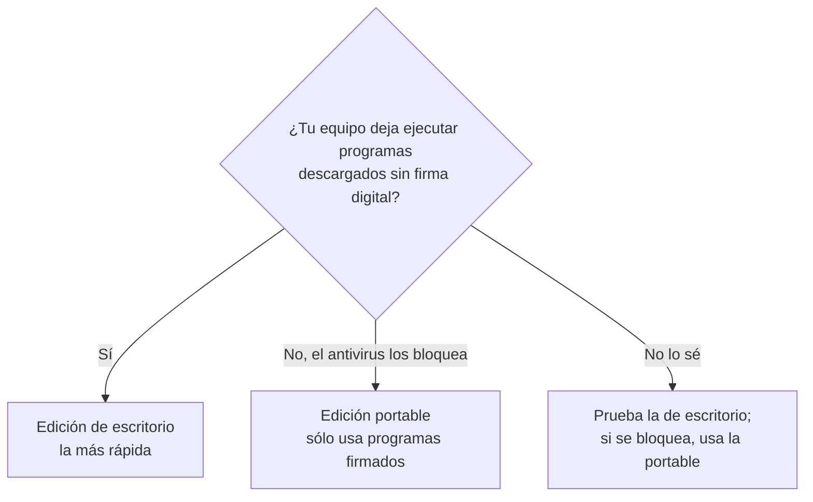
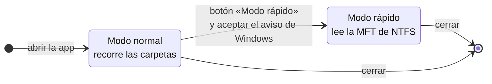
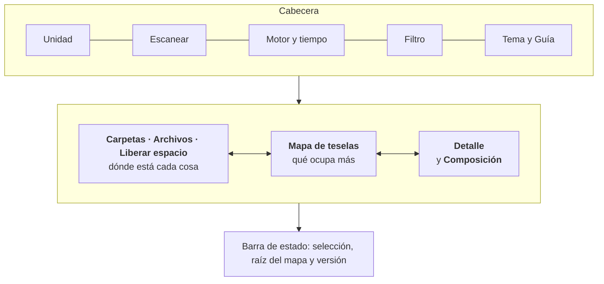
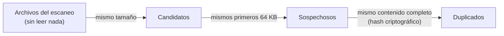
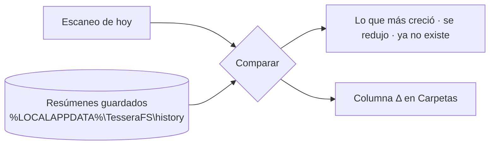

# Guía de usuario

TesseraFS te muestra **qué ocupa tu disco** en unos segundos. Dibuja la unidad como un mosaico: cada tesela es un archivo, su área es su tamaño y las carpetas agrupan sus teselas bajo una cabecera. Con un clic sabes qué es una tesela y dónde está; con otro, la tienes ubicada en el árbol de carpetas.


> [!NOTE]
> Todas las capturas de esta guía usan **datos de ejemplo** de la edición demo. Nada de lo que ves es el disco de una persona real.

## Contenido

1. [Elegir edición](#1-elegir-edición)
2. [Primer escaneo](#2-primer-escaneo)
3. [La pantalla de un vistazo](#3-la-pantalla-de-un-vistazo)
4. [Leer el mapa](#4-leer-el-mapa)
5. [Colores: categoría, extensión y antigüedad](#5-colores-categoría-extensión-y-antigüedad)
6. [Panel Carpetas](#6-panel-carpetas)
7. [Panel Archivos](#7-panel-archivos)
8. [Panel de detalle y acciones](#8-panel-de-detalle-y-acciones)
9. [Filtrar](#9-filtrar)
10. [Liberar espacio](#10-liberar-espacio)
    - [OneDrive y compresión](#onedrive-y-compresión)
    - [Archivos duplicados](#archivos-duplicados)
    - [Qué ha cambiado: historial y comparación](#qué-ha-cambiado-historial-y-comparación)
    - [Escaneo programado](#escaneo-programado)
    - [Exportar e informes](#exportar-e-informes)
11. [Atajos de teclado](#11-atajos-de-teclado)
12. [Personalizar](#12-personalizar)
13. [Privacidad y seguridad](#13-privacidad-y-seguridad)
14. [Trucos](#14-trucos)

---

## 1. Elegir edición

TesseraFS tiene dos ediciones con **la misma interfaz y los mismos resultados**. Cambia cómo se ejecuta.

| | Escritorio | Portable |
|---|---|---|
| Qué es | Un único `tesserafs-desktop.exe` (≈11 MB) | Una carpeta con `bun.exe`, `tesserafs.js` y un lanzador (≈94 MB) |
| Ventana | Propia (WebView2) | Una ventana de aplicación de Microsoft Edge |
| Velocidad en C:\ con 1,5 M elementos | **1,8 s** con administrador · 4–5 s sin él | 9 s con administrador · 5–6 s sin él |
| Instalación | Ninguna: se copia y se ejecuta | Ninguna: se copia la carpeta |
| Ideal para | Tu propio equipo | Equipos de empresa donde el antivirus bloquea ejecutables sin firma |



> [!NOTE]
> **¿Usas Linux?** La edición de escritorio también existe para Linux (AppImage, `.deb` y línea de comandos). Qué cambia y cómo instalarla: **[TesseraFS en Linux](linux.md)**.

> [!TIP]
> La edición portable no lleva ningún ejecutable propio. Sólo usa `bun.exe`, firmado por su editor, y Edge, que ya viene con Windows. Por eso suele funcionar donde el antivirus corporativo bloquea otros programas.

### Descargar

Cada versión se publica en la página **Releases** del repositorio:

| Archivo | Edición |
|---|---|
| `TesseraFS-X.Y.Z-instalador-win-x64.exe` (≈3 MB) | Escritorio, con instalador: **lo recomendado** |
| `TesseraFS-X.Y.Z-escritorio-win-x64.zip` (≈5 MB) | Escritorio, sin instalar (incluye `tessera-cli.exe`) |
| `TesseraFS-X.Y.Z-portable-win-x64.zip` (≈37 MB) | Portable |
| `SHA256SUMS.txt` | Sumas para comprobar que la descarga está íntegra |

**Con Scoop:** `scoop bucket add tesserafs https://github.com/hernansp08-hub/scoop-tesserafs` y después `scoop install tesserafs` (instala la edición de escritorio y deja `tessera-cli` en el PATH; se actualiza con `scoop update tesserafs`).

**Con el instalador:** ábrelo y sigue los pasos. Se instala sólo para tu usuario (en `%LOCALAPPDATA%\TesseraFS`), sin pedir administrador, con acceso en el menú Inicio. Para actualizar, instala la versión nueva encima. Se desinstala desde Configuración › Aplicaciones; tu historial de escaneos se conserva.

**Con un zip:**

1. Descarga el zip de tu edición.
2. **Desbloquéalo antes de descomprimir:** clic derecho › Propiedades › marca **Desbloquear** › Aceptar. Windows marca todo lo descargado de internet y, sin este paso, cada archivo extraído hereda la marca: más avisos al abrirlo.
3. Clic derecho › **Extraer todo…** en la carpeta que prefieras.

> [!TIP]
> Para comprobar que el zip no se ha dañado ni modificado, compara su suma con la de `SHA256SUMS.txt`:
> ```powershell
> Get-FileHash .\TesseraFS-0.2.0-portable-win-x64.zip
> ```

### Escritorio

1. Copia `tesserafs-desktop.exe` donde quieras (por ejemplo, `C:\Herramientas`).
2. Ábrelo con doble clic. Si Windows muestra *"Windows protegió su PC"*, pulsa **Más información › Ejecutar de todas formas**: el ejecutable aún no está firmado.
3. Necesita WebView2, que viene de serie en Windows 11 y en Windows 10 actualizado.

### Portable

1. Copia la carpeta `TesseraFS-portable` completa (a un USB, a tu carpeta de usuario…).
2. Ejecuta **`TesseraFS.cmd`**. Se abre una ventana de aplicación de Edge sin consola visible.
3. Al cerrar la ventana, TesseraFS termina solo en menos de un segundo. Tus otras ventanas de Edge no se tocan.

`TesseraFS.vbs` hace lo mismo sin el parpadeo de consola. Microsoft está retirando VBScript y muchas empresas lo bloquean, así que el `.cmd` es la opción recomendada.

---

## 2. Primer escaneo

Al abrir la app, la pantalla de inicio muestra **todas las unidades** con su uso y su espacio libre; la barra se vuelve ámbar por encima del 85 %. Pulsa una para escanearla, o escribe abajo la ruta de una carpeta y pulsa **Analizar**.

También puedes elegir la unidad en el selector de la cabecera y pulsar **Escanear**.


Mientras escanea, la tarjeta central muestra la fase, el porcentaje, los elementos encontrados, los datos leídos y el tiempo. El mosaico se llena con el **progreso real**.

**Cancelar:** durante el escaneo, el botón Escanear pasa a **Cancelar** (también vale **Esc** o el botón de la tarjeta). Si ya tenías un escaneo anterior y el motor lo conserva, se vuelve a él; si no, vuelves a la pantalla de unidades.

### Ponerse al día sin escanear todo

Después de borrar o mover cosas no hace falta repetir el escaneo completo:

- **Volver a escanear esta carpeta** (clic derecho en una carpeta, o el botón del panel de detalle) lee sólo esa carpeta y la sustituye en el árbol. El resto del escaneo, la selección y el mapa se conservan.
- **Actualizar** (aparece en la cabecera con la edición de escritorio en modo rápido, sobre una unidad NTFS local) pregunta a Windows qué cambió desde el escaneo, con su *diario de cambios*, y vuelve a escanear sólo esas carpetas. Si Windows no puede decirlo todo (el diario se reinició o es muy antiguo), hace un escaneo completo.
- **F5** hace siempre lo más rápido disponible: Actualizar si se puede, si no la carpeta del mapa, y en la raíz un escaneo completo.

> [!NOTE]
> Al volver a escanear se quita la comparación de la pestaña Cambios y los resultados de Duplicados, porque se refieren al árbol anterior. Lo marcado para borrar que siga existiendo se conserva. Un archivo con enlaces duros dentro y fuera de la carpeta puede contarse dos veces hasta el siguiente escaneo completo.

### Modo rápido (con administrador) y modo normal

TesseraFS tiene dos formas de leer el disco y elige sola la mejor posible:



| | Modo normal | Modo rápido |
|---|---|---|
| Permisos | Los de tu usuario | Administrador |
| Cómo lee | Carpeta a carpeta | La tabla maestra de archivos (MFT) de una vez |
| Velocidad típica (1,5 M elementos) | 4–6 s | 1,8 s (escritorio) |
| Ve las carpetas protegidas | No, las omite y avisa | Sí |
| Unidades | Cualquiera: NTFS, FAT, exFAT, red | Sólo NTFS locales |

La pastilla junto al botón Escanear indica qué modo se usó: **MFT** o **Recorrido**.

> [!IMPORTANT]
> El modo rápido sólo **lee**. TesseraFS nunca escribe en el volumen ni en la MFT; necesita permisos de administrador únicamente porque Windows reserva a los administradores la lectura directa del disco.

### Analizar una carpeta

En el selector de unidad, escribe una ruta en **Analizar una carpeta** (por ejemplo, `C:\Users\tu-usuario\Downloads`) y pulsa **Analizar**. Con permisos de administrador, la edición de escritorio también usa la MFT para carpetas sueltas; la portable las recorre siempre en modo normal.

**Desde el Explorador:** con el instalador, el clic derecho en una carpeta, en el fondo de una carpeta abierta o en una unidad tiene **Analizar con TesseraFS**, que abre la app escaneando ese sitio. En Windows 11 está en **Mostrar más opciones** (o Mayús+F10). Se instala sólo para tu usuario y la desinstalación lo quita. También vale desde una terminal: `tesserafs-desktop.exe "D:\Proyectos"` (en Linux, `tesserafs-desktop /ruta`).

---

## 3. La pantalla de un vistazo



Las tres zonas están **enlazadas por una única selección**: lo que eliges en una se marca en las otras dos. Puedes ajustar su ancho con los divisores (ver [Personalizar](#12-personalizar)).

---

## 4. Leer el mapa

| Lo que ves | Qué significa |
|---|---|
| Área de una tesela | El tamaño del archivo. El doble de área es el doble de espacio. |
| Cabecera con nombre y tamaño | Una carpeta; sus teselas están debajo |
| Juntas entre teselas | Separan carpetas y archivos, como en un mosaico |
| Tesela gris rayada | Muchos archivos pequeños de esa carpeta agrupados (pasa el puntero para ver cuántos) |
| Contorno de color de acento | El elemento seleccionado |
| Contorno blanco y discontinuo | La tesela bajo el puntero y su carpeta |
| Nombre en el centro | Archivos lo bastante grandes como para rotularlos |

**Con el ratón:**
- **Pasar el puntero:** nombre, ruta, tamaño, porcentaje del mapa, tipo y antigüedad.
- **Clic:** ubica el elemento en el panel **Carpetas**, que se despliega y desplaza hasta la fila.
- **Doble clic:** entra en la carpeta, con una transición de zoom.
- **Clic derecho:** abrir, mostrar en el Explorador, copiar ruta, entrar, ubicar, propiedades o papelera.

**Para volver atrás:** pulsa una carpeta de las migas de pan (`C:\ › apps › proyecto`), el botón **↑** o la tecla **Retroceso**.

**Estilos:**
- **Mosaico** (por defecto): teselas planas con juntas y cabeceras; lo más legible.
- **Relieve**: sombreado tridimensional; cada archivo parece un cojín y los grupos se distinguen por su forma.

El botón **T** muestra u oculta cabeceras y nombres.


> [!TIP]
> Las teselas más pequeñas que un par de píxeles no se dibujan una a una: se agrupan en la tesela rayada de su carpeta. Haz doble clic en ella para entrar en la carpeta y verlas.

---

## 5. Colores: categoría, extensión y antigüedad

Elige el color con los botones del mapa o con las teclas **1**, **2** y **3**. El panel **Composición** cambia a la vez.

| Modo | Para qué sirve |
|---|---|
| **Categoría** (1) | Ver de un vistazo qué *tipo* de contenido domina: juegos, vídeos, compilaciones… |
| **Extensión** (2) | Las 16 extensiones que más ocupan tienen color propio; el resto, gris |
| **Antigüedad** (3) | Encontrar lo que lleva años sin modificarse |

Categorías y algunos ejemplos de extensión:

| Categoría | Extensiones típicas |
|---|---|
| Vídeo | mp4, mkv, mov, avi |
| Imágenes | jpg, png, heic, raw, psd |
| Audio | mp3, wav, flac, bank |
| Documentos | pdf, docx, xlsx, pptx, txt |
| Código | js, ts, py, rs, json, html |
| Compilación | o, obj, lib, rlib, pdb, pyc, jar |
| Aplicaciones | exe, dll, msi, sys, cab |
| Comprimidos y discos | zip, 7z, iso, vhdx, wim |
| Juegos | pak, assets, ress, cok, bsa |
| Datos y modelos | gguf, safetensors, onnx, db, parquet |
| Otros | Sin extensión, temporales, registros… |


En **Antigüedad**, los tramos son: último mes, hasta 6 meses, hasta 1 año, hasta 3 años y más de 3 años. Pulsa un tramo en Composición para resaltar sólo esas teselas.

> [!TIP]
> Combina **Antigüedad** con un filtro: `age:>2y size:>500m` te deja a la vista lo grande que nadie toca desde hace dos años.

---

## 6. Panel Carpetas

| Columna | Significado |
|---|---|
| Nombre | Con su icono: carpeta, o color del archivo según el modo de color |
| Tamaño | Tamaño lógico: lo que ocupa el contenido |
| % | Proporción dentro de su carpeta. La barra de fondo de la fila la muestra de forma visual. |
| En disco | Espacio realmente asignado: puede ser menor si está comprimido o en la nube |
| Elementos | Archivos y carpetas que contiene |
| Modificado | Fecha de la última modificación |

- Pulsa en los encabezados para **ordenar**; vuelve a pulsar para invertir el orden.
- Las carpetas con muchos hijos cargan de 500 en 500: pulsa **Mostrar 500 más** al final de la lista.
- Los nombres largos se recortan **por el medio** y conservan la extensión (`VT_Di…mo.cok`). Al pasar el puntero se ve el nombre completo.
- Las columnas se ocultan solas cuando el panel es estrecho. Ensánchalo con el divisor para verlas todas.
- Los elementos ocultos aparecen atenuados; los **enlaces duros**, en cursiva.

---

## 7. Panel Archivos

Sin filtro, muestra los **archivos más grandes** de la carpeta que tengas abierta en el mapa (hasta 2.000). Con un filtro, muestra sus resultados en todo el escaneo.


- Un clic selecciona el archivo y lo marca en el mapa.
- Un doble clic lo ubica en el panel Carpetas.
- La columna Carpeta se recorta por el medio para que siempre veas la carpeta final.

---

## 8. Panel de detalle y acciones

Arriba a la derecha está todo sobre lo seleccionado: tipo, tamaño, porcentaje del total, ruta completa (con botón de copiar), espacio en disco, proporción dentro de su carpeta, número de archivos y carpetas, atributos y fechas.

| Acción | Qué hace |
|---|---|
| Mostrar en el Explorador | Abre el Explorador con el elemento seleccionado |
| Entrar en el mapa | Hace de esa carpeta la raíz del mapa |
| Marcar para borrar | Lo añade a la pestaña **Para borrar** (ver abajo) |
| Liberar espacio (dejar sólo en línea) | Sólo en archivos y carpetas de OneDrive con algo descargado: lo deja sólo en la nube, sin borrar nada (ver [OneDrive y compresión](#onedrive-y-compresión)) |
| Papelera… | Pide confirmación en el propio panel y lo mueve a la **Papelera de reciclaje** |

> [!CAUTION]
> TesseraFS nunca borra de forma definitiva. Mover a la papelera siempre pide confirmación y se puede deshacer desde la Papelera de Windows. Aun así, revisa la pestaña [Liberar espacio](liberar-espacio.md) antes de borrar archivos del sistema.

### Borrar varias cosas a la vez: «Para borrar»

Ve marcando lo que quieras quitar y bórralo todo de una vez cuando lo hayas revisado:

- **Ctrl+clic** sobre una tesela del mapa o una fila de Carpetas o Archivos.
- **Espacio** sobre la fila seleccionada.
- **Marcar para borrar** en el panel de detalle o en el menú del clic derecho.
- **Marcar** en las tarjetas de [Liberar espacio](liberar-espacio.md). En las tarjetas que agrupan archivos (modelos de IA, descargas) se marcan esos archivos, no su carpeta.

Lo marcado se tacha en las listas y se tiñe de rojo en el mapa. La pestaña **Para borrar** muestra el total y la lista, y la barra de estado lleva un contador que la abre. El total no cuenta nada dos veces: al marcar una carpeta se quita lo que ya estaba marcado dentro, y no se puede añadir algo que ya está dentro de una carpeta marcada.

**Mover todo a la papelera…** pide una sola confirmación y mueve los elementos de uno en uno. Si alguno no se puede mover (está en uso, no cabe en la Papelera…), se queda en la lista con el motivo. La lista se vacía al hacer un escaneo nuevo.

**Composición** (debajo) resume el espacio de la carpeta del mapa por categoría, extensión o antigüedad. Pulsa una fila para resaltar sus teselas, y en modo Categoría verás también sus extensiones principales.

---

## 9. Filtrar

Pulsa **Ctrl K** (o **Ctrl F**) y escribe. Los resultados aparecen en **Archivos** y el mapa atenúa todo lo demás.

```text
ext:gguf,safetensors          modelos de IA
size:>1g                      archivos de más de 1 GB
age:>2y size:>100m            grandes y sin tocar en dos años
path:Downloads ext:msi,exe    instaladores olvidados en Descargas
-ext:dll size:>500m           grandes que no son DLL
attr:cloud alloc:>0           archivos de OneDrive descargados en este equipo
```

La referencia completa y un recetario están en **[Filtros](filtros.md)**. El botón **?** junto al campo muestra ejemplos que se aplican con un clic.

### Descubrir y búsquedas guardadas

El botón de la brújula, junto al campo, abre **Descubrir**: búsquedas preparadas que se aplican con un clic (lo de más de 1 GB, lo cambiado esta semana, lo grande y viejo, carpetas con más de 10.000 archivos, carpetas y archivos vacíos, enlaces, enlaces duros, archivos dispersos, ocultos y, en Windows, los de la nube y los comprimidos).

Debajo están **tus búsquedas guardadas**: escribe un filtro, abre Descubrir, ponle nombre y pulsa **Guardar**. La × de cada una la quita. Se guardan en este equipo, en la propia app.

---

## 10. Liberar espacio

La pestaña **Liberar espacio** busca candidatos y los clasifica en tres niveles:

| Nivel | Significa |
|---|---|
| 🟢 **Seguro** | Se regenera solo o es temporal: compilaciones, dependencias, temporales |
| 🟡 **Revisar** | Es tuyo y puede que lo quieras: juegos, modelos, discos virtuales, descargas |
| 🔴 **No borrar a mano** | Lo gestiona Windows: paginación, WinSxS, caché de instaladores |

Cada tarjeta explica qué es, cuánto ocupa y cómo liberarlo bien: con la orden adecuada (`cargo clean`, `DISM …`, con botón de copiar) o con el ajuste de Windows correspondiente. Pulsa **Ubicar** para verlo en el árbol y en el mapa.


Detalles y procedimientos seguros en **[Liberar espacio](liberar-espacio.md)**.

### OneDrive y compresión

Hay espacio que se puede recuperar **sin borrar nada**:

- **OneDrive descargado.** Si OneDrive usa **Archivos a petición** y lo descargado ocupa más de 200 MB en disco, aparece una tarjeta con el botón **Liberar espacio**. Hace lo mismo que el Explorador (clic derecho › Liberar espacio): los archivos quedan **sólo en línea**, siguen en OneDrive y se vuelven a descargar al abrirlos. También funciona con una carpeta o un archivo concretos, desde el panel de detalle o el menú del clic derecho. OneDrive los vacía en segundo plano; unos segundos después TesseraFS vuelve a escanear la carpeta para mostrar el espacio recuperado. Sin Archivos a petición, OneDrive guarda todo descargado y no hay nada que liberar así: actívalo en la configuración de OneDrive (Sincronización y copia de seguridad › Configuración avanzada › Archivos a petición).
- **Juegos sin comprimir.** La tarjeta de cada juego propone una orden `compact /c /s /i /q /exe:lzx "…\*"` para comprimirlo con la compresión de Windows. Se juega igual y suele ocupar bastante menos. Ejecútala en una terminal (como administrador si el juego está en `Program Files`); las actualizaciones pueden descomprimir los archivos que cambien.

El panel de detalle indica si un archivo de la nube está **descargado** o **sólo en línea**, y cuánto ahorra la **compresión** cuando ocupa en disco claramente menos que su tamaño. En [Filtros](filtros.md), `attr:cloud`, `attr:compressed` y el resto de atributos buscan por esas marcas.

### Archivos duplicados

La pestaña **Duplicados** busca archivos con **exactamente el mismo contenido**, aunque tengan nombres distintos.

1. Elige dónde buscar (la carpeta del mapa o todo lo escaneado) y el tamaño mínimo (por defecto, 1 MB).
2. Pulsa **Buscar duplicados**. Se puede cancelar en cualquier momento.
3. Revisa los grupos, ordenados por el espacio que recuperarías. **Marcar las copias** conserva la más antigua de cada grupo y manda las demás a [Para borrar](#borrar-varias-cosas-a-la-vez-para-borrar); también puedes marcar o desmarcar cada archivo con su casilla.



Sólo se lee lo imprescindible: la mayoría de archivos se descartan por tamaño sin abrirlos, y la mayoría de los que quedan, con sus primeros 64 KB. Quedan fuera:

- los **enlaces duros**: son el mismo archivo con dos nombres, así que borrar uno no libera nada;
- los archivos de **OneDrive que sólo están en la nube**: leerlos obligaría a descargarlos.

> [!TIP]
> Si todas las copias de un grupo quedan marcadas, el grupo se pone en rojo para que conserves al menos una. **Resaltar en el mapa** muestra dónde están todas las copias.

**Qué copia se conserva:** junto a **Marcar las copias** eliges **Conservar**: la más antigua (lo normal), la más reciente, la de ruta más corta o **las de la carpeta del mapa**. Con esta última, la carpeta que tienes en el mapa hace de «referencia» (por ejemplo, tu carpeta de fotos ordenada): se conservan todas las copias que están dentro y se marcan las de fuera, sólo en los grupos que tienen alguna en cada lado.

### Qué ha cambiado: historial y comparación

Después de cada escaneo, TesseraFS guarda un **resumen** en tu equipo: el tamaño de todas las carpetas y de los archivos de 1 MB o más. La pestaña **Cambios** lista los escaneos anteriores de la misma unidad o carpeta y, con **Comparar**, muestra:

- cuánto creció o se redujo todo desde entonces, y cuántos archivos más o menos hay;
- **lo que más creció**: las carpetas y archivos que explican el crecimiento, marcados como **nuevo** si no existían. No se repiten las carpetas padre cuando una sola subcarpeta explica casi todo;
- lo que **se redujo** y lo que **ya no existe**.

**Evolución.** Arriba de la pestaña, un gráfico muestra cómo ha cambiado el tamaño en todos los escaneos guardados de esa ubicación (pasa el ratón por un punto para ver la fecha, el tamaño y el cambio). Con tres escaneos en días distintos aparece la tendencia: cuánto crece o se reduce por semana y, si es una unidad entera, **cuándo se acabaría el espacio libre** a este ritmo, con la línea discontinua de la estimación. En el panel de detalle, **Evolución** hace lo mismo con la carpeta o el archivo seleccionado: cuánto ha cambiado desde el escaneo más antiguo.

Mientras la comparación está activa, el árbol de Carpetas tiene una columna **Δ** (pulsa su cabecera para ordenar por cambio) y el panel de detalle muestra el cambio de lo seleccionado. **Resaltar lo que creció** lo marca en el mapa; **Dejar de comparar** lo quita todo.



> [!NOTE]
> Los resúmenes se quedan en `%LOCALAPPDATA%\TesseraFS\history` (unos pocos MB por unidad completa) y se conservan los 20 últimos de cada ubicación. Puedes desactivar el guardado automático, guardar a mano o borrar el historial desde la propia pestaña. Las dos ediciones comparten el mismo historial.

### Escaneo programado

Sólo en la edición de escritorio. Al final de la pestaña **Cambios**, **Escaneo programado** escanea una unidad o carpeta cada día o cada semana a la hora que elijas, **sin abrir la app**: guarda un resumen en el historial (así la **Evolución** se completa sola) y, si el espacio libre de esa unidad baja del porcentaje que indiques, te avisa con una notificación del sistema. Pon **0 %** si no quieres avisos.

- **Windows**: crea la tarea «TesseraFS scheduled scan» en el Programador de tareas, para tu usuario y sin administrador. Se ejecuta con la sesión iniciada, también con el portátil a batería, y si el equipo estaba apagado a esa hora, en cuanto vuelvas a encenderlo.
- **Linux**: crea un temporizador de systemd de tu usuario (`~/.config/systemd/user/tesserafs-scan.timer`), que también se pone al día al encender el equipo. Hace falta systemd; el aviso usa `notify-send`, si está instalado.

Debajo verás cuándo se ejecutó por última vez, cuánto ocupaba y el espacio libre que quedaba, o el error si falló. **Cambiar** y **Quitar** hacen lo que dicen; quitarlo borra la tarea o el temporizador y deja el historial.

> [!NOTE]
> El escaneo programado no pide administrador, así que usa el modo normal (recorre las carpetas) y no ve las que tu usuario no puede abrir. La programación se guarda en `%LOCALAPPDATA%\TesseraFS\schedule.json` (en Linux, `~/.local/share/TesseraFS`). Con el instalador de Windows, desinstalar la app quita la tarea y al instalar otra versión se vuelve a crear; con el zip o Scoop, quítala desde la app antes de borrarla. Si usas la AppImage y la cambias de sitio o de nombre, vuelve a guardar la programación para que apunte al archivo nuevo.

### Exportar e informes

El botón de **Exportar** de la cabecera (la flecha hacia abajo) guarda en `Descargas\TesseraFS`:

| Opción | Qué genera |
|---|---|
| **Informe** (HTML) | Una página autocontenida, lista para enviar o imprimir: resumen, mapa, composición, carpetas y archivos más grandes, y, si los tienes, Liberar espacio, duplicados y cambios |
| **Mapa como imagen** (PNG) | El mapa tal como se ve |
| **Hoja de cálculo** (CSV) | La lista de la pestaña activa: el contenido de la carpeta del mapa, los archivos, los candidatos, los duplicados, los cambios o lo marcado para borrar. Se abre directamente en Excel (con «;» si tu idioma usa coma decimal) |
| **Datos para scripts** (JSON) | Lo mismo, con todos los campos |

Al terminar, el aviso tiene un botón **Mostrar** que abre el Explorador con el archivo seleccionado.

### Guardar un escaneo y abrirlo en otro sitio

En el mismo menú, **Guardar el escaneo completo** crea un archivo `.tessera` en `Descargas\TesseraFS` con todo lo escaneado (carpetas, archivos, tamaños y atributos), y **Abrir un escaneo guardado…** lo vuelve a cargar, en este equipo o en otro. Sirve para:

- revisar con calma el disco de otro equipo (el de un familiar, el de un compañero), que te manda su `.tessera`;
- analizar un servidor o un NAS desde tu equipo: allí se escanea con `tessera-cli scan /ruta --save datos.tessera` ([línea de comandos](linea-de-comandos.md)) y aquí se abre;
- guardar cómo estaba un disco antes de un cambio grande.

Un escaneo abierto desde archivo se ve igual (mapa, árbol, filtros, Liberar espacio, exportar), pero la cabecera dice **ARCHIVO** con la fecha y el equipo de origen, y no ofrece acciones sobre el disco: ni abrir, ni papelera, ni volver a escanear, duplicados o historial. Las reglas de limpieza son las del sistema del escaneo (un `.tessera` de Linux abierto en Windows usa las de Linux). Un escaneo normal vuelve al disco.

> [!IMPORTANT]
> Un `.tessera` contiene los nombres y rutas de todo lo escaneado. Antes de compartirlo, piensa si eso incluye algo privado.

---

## 11. Atajos de teclado

| Tecla | Acción |
|---|---|
| **Ctrl K** · **Ctrl F** | Ir al filtro |
| **↑ ↓** | Moverse por el árbol |
| **→ ←** | Expandir o plegar carpeta (o ir al padre) |
| **Intro** | Entrar en la carpeta seleccionada en el mapa |
| **Retroceso** | Subir un nivel en el mapa |
| **1 · 2 · 3** | Color por categoría, extensión o antigüedad |
| **Espacio** | Marcar o desmarcar la fila para borrar |
| **Ctrl+clic** | Marcar o desmarcar en el mapa y en las listas |
| **F5** | Actualizar: lo que cambió, la carpeta del mapa o un escaneo completo |
| **Supr** | Mover a la papelera (pide confirmación) |
| **Esc** | Cancelar el escaneo, quitar el resaltado, cancelar la confirmación o cerrar menús |
| Divisor + **← →** / **↑ ↓** | Redimensionar paneles (con **Mayús**, pasos largos) |
| Divisor + **Inicio** | Restablecer el tamaño del panel |

---

## 12. Personalizar

- **Idioma:** el botón del globo, en la cabecera, elige entre automático (el idioma de Windows) y English, Español, Português (Brasil), Français o Deutsch. El cambio es inmediato y no pierde el escaneo; la elección se recuerda.
- **Tema:** el botón de la cabecera alterna entre sistema, oscuro y claro. Los colores de las teselas son los mismos en los dos temas.
- **Divisores:** arrastra la línea entre paneles para cambiar su ancho (o su alto en pantallas medianas). El doble clic la restablece. Se recuerda entre sesiones.
- **Enlaces directos:** abre la interfaz en una vista concreta añadiendo a la dirección `#archivos`, `#limpieza`, `#duplicados`, `#cambios`, `#extension`, `#antiguedad`, `#relieve` o `#guia` (o sus nombres en inglés: `#files`, `#clean`, `#duplicates`, `#changes`, `#age`, `#relief`, `#guide`). `#lang=fr` fuerza un idioma. Se pueden combinar: `#lang=de,relieve,extension`.


---

## 13. Privacidad y seguridad

- **Nada sale de tu equipo.** La interfaz no hace ninguna petición a internet; hasta las fuentes van incluidas.
- **Sólo lectura.** El escaneo nunca modifica tus archivos ni abre su contenido. Tampoco descarga los archivos de OneDrive que sólo están en la nube.
- **Portable:** el servidor interno sólo escucha en `127.0.0.1` y exige un código secreto aleatorio en cada petición. Ninguna web ni ningún otro equipo pueden usarlo.
- **Borrar:** sólo a la Papelera y siempre con confirmación.

---

## 14. Trucos

> [!TIP]
> **Encuentra lo grande en dos clics.** Al terminar el escaneo, el archivo más grande ya está seleccionado y ubicado en el árbol. Pulsa la tesela más grande del mapa y luego **Mostrar en el Explorador**.

> [!TIP]
> **Compara antes y después.** Tras borrar algo, vuelve a pulsar **Escanear**: en el modo rápido tarda un par de segundos.

> [!TIP]
> **Proyectos de programación.** Filtra `type:dir name:node_modules` o `type:dir name:target` y ordena por tamaño en Archivos. Liberar espacio ya te propone las que se pueden regenerar.

> [!TIP]
> **Equipo lento al escanear.** La primera vez tras reiniciar puede tardar más porque Windows aún no tiene las carpetas en caché. Cierra otros analizadores o instaladores que estén leyendo el disco al mismo tiempo.

> [!TIP]
> **Teselas demasiado pequeñas.** Entra en la carpeta con doble clic: el mapa se recalcula y lo pequeño pasa a verse en detalle.
