# Liberar espacio

La pestaña **Liberar espacio** revisa lo escaneado y te propone qué se puede recuperar. No borra nada por sí sola: para cada candidato explica **qué es**, **cuánto ocupa** y **cuál es la forma correcta de liberarlo**.

## Los tres niveles

| Nivel | Significa | Qué hacer |
|---|---|---|
| 🟢 **Seguro** | Se regenera solo o es temporal | Puedes liberarlo sin pensarlo mucho, preferiblemente con la orden indicada |
| 🟡 **Revisar** | Es tuyo y quizá lo necesites | Decide tú: borra desde la propia herramienta (tienda, gestor de modelos…) |
| 🔴 **No borrar a mano** | Lo gestiona Windows | Usa la herramienta de Windows indicada. Borrarlo a mano puede romper el sistema. |

El resumen de arriba suma cuántos gigas hay en cada nivel.

Cada tarjeta tiene **Ubicar** (lo despliega en el árbol y lo amplía en el mapa) y, salvo las rojas, **Marcar**, que lo añade a la pestaña [Para borrar](guia.md#borrar-varias-cosas-a-la-vez-para-borrar). En las tarjetas que agrupan archivos (modelos de IA, descargas) se marcan esos archivos, no la carpeta que los contiene.

### «¿Qué es esto?» en el panel de detalle

Al seleccionar cualquier carpeta o archivo, el panel de detalle explica qué es si lo reconoce:

- si coincide con una regla de esta página, muestra su nivel, la explicación y la orden o el ajuste para liberarlo, aunque sea más pequeño que el mínimo de la tarjeta;
- si es una carpeta conocida de Windows (`Windows`, `System32`, `Program Files`, `ProgramData`, `AppData`, `Packages`, `OneDrive`, `Descargas`, `steamapps`…), explica para qué sirve y cómo liberar espacio sin romper nada.

## ¿Puedo borrar esto?

```mermaid
flowchart TD
    A["Un elemento grande"] --> B{"¿Está en Liberar espacio?"}
    B -->|"Sí, 🟢 Seguro"| S["Usa la orden o el ajuste<br/>que propone la tarjeta"]
    B -->|"Sí, 🟡 Revisar"| R{"¿Lo sigues usando?"}
    R -->|No| R2["Bórralo desde su programa:<br/>tienda de juegos, gestor de modelos…"]
    R -->|Sí| K["Déjalo, o muévelo a otra unidad"]
    B -->|"Sí, 🔴 No borrar a mano"| W["Sólo con la herramienta de Windows<br/>indicada en la tarjeta"]
    B -->|No| C{"¿Está dentro de Windows,<br/>Program Files o ProgramData?"}
    C -->|Sí| N["No lo borres a mano:<br/>desinstala el programa"]
    C -->|No| D{"¿Es tuyo y sabes qué es?"}
    D -->|Sí| T["Papelera… desde el panel de detalle"]
    D -->|No| I["Investiga primero:<br/>Mostrar en el Explorador, Propiedades"]
```

## Qué detecta y cómo liberarlo

### 🟢 Seguro

| Candidato | Cómo lo reconoce | Cómo liberarlo |
|---|---|---|
| **Compilaciones de Rust** | Carpetas `target` de más de 50 MB que contienen la marca de Cargo (`CACHEDIR.TAG` o `.rustc_info.json`) | `cargo clean` dentro del proyecto. La siguiente compilación será más lenta. |
| **Dependencias de Node** | Carpetas `node_modules` de más de 20 MB que no están dentro de otra `node_modules` | Borra la carpeta y reinstala con `bun install` o `npm install` |
| **Entornos virtuales de Python** | Carpetas `.venv` de más de 20 MB | Borra la carpeta y recréala con `uv sync` o `pip install -r requirements.txt` |
| **Archivos temporales** | `%LOCALAPPDATA%\Temp` y `C:\Windows\Temp` | Configuración › Sistema › Almacenamiento › Archivos temporales |
| **Descargas de Windows Update** | `C:\Windows\SoftwareDistribution` | El mismo ajuste, opción «Limpieza de Windows Update» |
| **Instalación anterior de Windows** | `C:\Windows.old` | El mismo ajuste, opción «Instalaciones anteriores de Windows». Windows la borra solo pasados unos días. |
| **Papelera de reciclaje** | `$Recycle.Bin` de más de 10 MB | Vacía la papelera |
| **Cachés de paquetes de desarrollo** | Las de npm, pnpm, Yarn, Bun, pip, uv, NuGet y Go, desde 200 MB | La orden de cada herramienta (`npm cache clean --force`, `pnpm store prune`, `pip cache purge`…), que propone la tarjeta |
| **Caché del navegador** | `Cache` y `Code Cache` de los perfiles de Chrome, Edge, Brave y Vivaldi, y `cache2` de Firefox, desde 100 MB | En el navegador: Configuración › Privacidad › Borrar datos de navegación › Imágenes y archivos almacenados en caché |
| **Optimización de distribución** | `DeliveryOptimization` de Windows, desde 100 MB | Configuración › Sistema › Almacenamiento › Archivos temporales |
| **Volcados de memoria e informes de errores** | `C:\Windows\MEMORY.DMP`, `Minidump`, `LiveKernelReports`, `%LOCALAPPDATA%\CrashDumps` e informes de WER, desde 50 MB | El mismo ajuste de Archivos temporales |
| **Caché de sombreadores** | `D3DSCache` y las de NVIDIA, AMD, Intel y Steam (`shadercache`), desde 200 MB | Bórrala con los juegos cerrados; la de DirectX está también en Archivos temporales. Los primeros arranques pueden ir a tirones. |
| **OneDrive descargado** | La carpeta de OneDrive de cada usuario (también las de empresa, `OneDrive - Empresa`) cuando lo descargado ocupa más de 200 MB **en disco** | Botón **Liberar espacio** de la tarjeta: deja los archivos sólo en línea, como el Explorador. No se borra nada; se vuelven a descargar al abrirlos |

> [!IMPORTANT]
> TesseraFS **ignora** las carpetas `node_modules`, `target` y `.venv` que están dentro de programas instalados: `Program Files`, `AppData`, `ProgramData`, extensiones de VS Code… Esas no se regeneran solas: borrarlas rompería el programa.

### 🟡 Revisar

| Candidato | Cómo liberarlo bien |
|---|---|
| **Modelos de IA locales** (`gguf`, `safetensors`, `ckpt`, `onnx`, agrupados por carpeta, desde 500 MB) | Desde la herramienta que los descargó: en LM Studio, *My Models*; en Ollama, `ollama rm <modelo>`. Así su catálogo sigue coherente. |
| **Discos virtuales** (`vhdx`, `vhd`, desde 500 MB) | Crecen pero no encogen solos. WSL: limpia dentro de la distribución y activa el modo disperso con `wsl --manage <distro> --set-sparse true`. Docker: `docker system prune -a`. |
| **Juegos instalados** (carpetas de `steamapps\common`, desde 1 GB) | Desinstálalos desde su tienda, o muévelos a otra unidad (Steam › Almacenamiento › Mover). No borres la carpeta a mano. Para conservarlo ocupando menos, la tarjeta propone comprimirlo con `compact /c /s /i /q /exe:lzx` (sólo si aún no está comprimido). |
| **Instaladores y archivos descargados** (`msi`, `exe`, `iso`, `zip`, `7z` de más de 100 MB en Descargas) | Si ya instalaste el programa, el instalador sobra |
| **Puntos de restauración** (`System Volume Information`) | `vssadmin list shadowstorage` muestra cuánto ocupan. Ajusta el máximo o borra los antiguos en Panel de control › Sistema › Protección del sistema › Configurar. |

### 🔴 No borrar a mano

| Candidato | Por qué | Si necesitas espacio |
|---|---|---|
| **Archivo de paginación** (`pagefile.sys`) | Memoria virtual de Windows | Rendimiento › Opciones avanzadas › Memoria virtual. Lo normal es dejarlo «administrado por el sistema». |
| **Archivo de hibernación** (`hiberfil.sys`) | Guarda la memoria al hibernar y acelera el arranque | `powercfg /h /type reduced` lo reduce; `powercfg /h off` lo elimina, pero desactiva la hibernación y el inicio rápido |
| **Archivo de intercambio** (`swapfile.sys`) | Lo usan las apps de la Tienda | Lo gestiona Windows |
| **Almacén de componentes** (`C:\Windows\WinSxS`) | Comparte enlaces duros con System32: ocupa menos de lo que aparenta | `DISM /Online /Cleanup-Image /StartComponentCleanup` como administrador |
| **Caché de Windows Installer** (`C:\Windows\Installer`) | Windows la necesita para reparar y desinstalar programas | No hay forma segura de reducirla a mano |
| **Caché de paquetes de instalación** (`C:\ProgramData\Package Cache`) | Instaladores de Visual Studio, .NET y otros, necesarios para reparar, modificar y desinstalar | Desinstala los programas o componentes que ya no uses (por ejemplo, desde el Instalador de Visual Studio) |
| **Almacén de controladores** (`C:\Windows\System32\DriverStore\FileRepository`) | Copia de cada controlador instalado, para reinstalar dispositivos | `pnputil /enum-drivers` lista los controladores; las versiones antiguas se quitan una a una con `pnputil /delete-driver oemNN.inf` |

> [!WARNING]
> No añadas `/ResetBase` a la orden de DISM si no sabes lo que hace: libera algo más, pero impide desinstalar las actualizaciones ya instaladas.

## Trucos

> [!TIP]
> **Ubicar antes de decidir.** El botón **Ubicar** de cada tarjeta despliega el árbol hasta el elemento y lo amplía en el mapa. Así ves qué hay dentro antes de tocar nada.

> [!TIP]
> **Los proyectos de programación son la mina de oro.** En equipos de desarrollo, las carpetas `target`, `node_modules` y `.venv` suelen sumar decenas de gigas que se regeneran con una orden.

> [!TIP]
> **Liberar sin borrar.** Lo que está en OneDrive no hace falta tenerlo descargado: **Liberar espacio** lo deja sólo en la nube. Y un juego o una carpeta que casi no cambia puede comprimirse con `compact /c /s /i /exe:lzx "carpeta\*"`; el panel de detalle muestra después cuánto ahorra.

> [!TIP]
> **Copia la orden.** El botón junto a cada orden (`cargo clean`, `DISM …`) la copia al portapapeles para pegarla en una terminal.

> [!TIP]
> **Después de liberar, vuelve a escanear.** Con el modo rápido son un par de segundos, y verás el cambio en el mapa.
