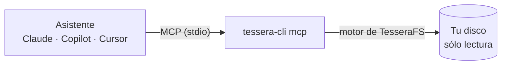

# Asistentes de IA (MCP)

`tessera-cli mcp` convierte TesseraFS en un **servidor MCP** ([Model Context Protocol](https://modelcontextprotocol.io)): Claude, GitHub Copilot en VS Code, Cursor y otros asistentes pueden preguntarle qué ocupa tu disco y contestarte con datos reales, en lugar de adivinar.



Le puedes pedir cosas como:

- «¿Qué ocupa tanto en C:? Dime las 10 carpetas más grandes de mi perfil.»
- «Busca modelos de IA locales de más de 1 GB y dime de qué programa son.»
- «¿Qué ha crecido en el disco desde el último escaneo guardado?»
- «¿Hay archivos duplicados de más de 100 MB en Descargas?»
- «Explícame qué es `C:\ProgramData\Package Cache` y si se puede limpiar.»
- «¿Qué puedo limpiar sin riesgo en mi carpeta de proyectos?»

## Qué hace y qué no

- **Sólo lee.** Escanea, busca, compara y busca duplicados. **Nunca borra, mueve ni cambia** tus archivos: si el asistente propone limpiar algo, lo haces tú (desde la app, que envía a la Papelera, o con la orden que te indique).
- La única escritura es `save_snapshot`, que guarda un resumen en el historial de TesseraFS, igual que la app al escanear.
- **Privacidad:** TesseraFS no envía nada a ningún sitio, pero **el asistente sí ve lo que le devuelven las herramientas** (rutas, nombres de archivo, tamaños y fechas) y lo procesa con su modelo, en la nube si no es local. No lo conectes si los nombres de tus archivos son confidenciales.
- Los escaneos se quedan en memoria mientras el asistente tiene abierto el servidor: la primera pregunta escanea y las siguientes contestan al instante. Cada respuesta dice cuándo se hizo el escaneo; el asistente puede pedir `refresh` para ponerlo al día.

## Dónde está `tessera-cli`

| Instalación | Ruta para la configuración |
|---|---|
| Instalador de Windows | `%LOCALAPPDATA%\TesseraFS\tessera-cli.exe`, p. ej. `C:\Users\ana\AppData\Local\TesseraFS\tessera-cli.exe` (o la carpeta que elegiste al instalar). El instalador añade esa carpeta a tu `PATH` |
| Zip de la edición de escritorio | `tessera-cli.exe` está en la carpeta donde lo descomprimiste, p. ej. `C:\Herramientas\TesseraFS\tessera-cli.exe` |
| [Scoop](https://scoop.sh) | `tessera-cli` (ya está en el `PATH`) |
| Linux, paquete `.deb` | `/usr/bin/tessera-cli` (ya está en el `PATH`) |
| Linux, AppImage | Va dentro, pero hay que sacarlo una vez, p. ej. a `~/.local/bin/tessera-cli` ([cómo](linux.md#la-línea-de-comandos)) |
| Linux (`TesseraFS-X.Y.Z-cli-linux-x64.tar.gz`) | Donde lo copiaste, p. ej. `/usr/local/bin/tessera-cli` |

En los ejemplos se usa `tessera-cli`; si no está en el `PATH`, pon la ruta completa (en JSON, con las barras dobladas: `C:\\Users\\ana\\AppData\\Local\\TesseraFS\\tessera-cli.exe`). Los programas que ya estaban abiertos al instalar no ven el `PATH` nuevo hasta que los reinicias; con la ruta completa funciona siempre.

## Conectarlo

### Claude Desktop

**Settings › Developer › Edit Config** (Configuración › Desarrollador) abre `claude_desktop_config.json`. Añade:

```json
{
  "mcpServers": {
    "tesserafs": {
      "command": "C:\\Users\\ana\\AppData\\Local\\TesseraFS\\tessera-cli.exe",
      "args": ["mcp"]
    }
  }
}
```

Reinicia Claude Desktop. Las herramientas de TesseraFS aparecen en el botón de herramientas del chat.

### Claude Code

```bash
claude mcp add --scope user tesserafs -- tessera-cli mcp
```

`--scope user` lo deja disponible en todos tus proyectos. Compruébalo con `claude mcp list`.

### VS Code (GitHub Copilot, modo agente)

Paleta de comandos › **MCP: Add Server…** › **Command (stdio)** y escribe `tessera-cli mcp`. O a mano, en `.vscode/mcp.json` del proyecto (o en la configuración de usuario):

```json
{
  "servers": {
    "tesserafs": {
      "type": "stdio",
      "command": "tessera-cli",
      "args": ["mcp"]
    }
  }
}
```

### Cursor y otros

Cursor (`~/.cursor/mcp.json`), Windsurf, Gemini CLI y la mayoría de clientes usan el mismo bloque que Claude Desktop: `"command"` con la ruta de `tessera-cli` y `"args": ["mcp"]`.

## Herramientas

| Herramienta | Para qué |
|---|---|
| `list_volumes` | Unidades y espacio libre, sin escanear |
| `scan` | Escanea una unidad o carpeta (o abre un `.tessera`) y la deja en memoria; con `refresh` la pone al día |
| `largest` | Los archivos y las carpetas más grandes bajo una carpeta |
| `list_folder` | El contenido de una carpeta ordenado por tamaño, nombre, fecha, archivos o cambio |
| `search` | Búsqueda con el [lenguaje de filtros](filtros.md): `ext:gguf size:>1g`, `age:>2y size:>500m`… |
| `file_types` | Espacio por extensión |
| `cleanup_candidates` | Qué se puede limpiar, con las mismas reglas que la pestaña [Liberar espacio](liberar-espacio.md): cada candidato con su riesgo (seguro, revisar o no borrar a mano), tamaño, por qué, cómo y la orden del propio programa (`cargo clean`, `npm cache clean --force`…). Con `risk` se filtra por riesgo (`ok`, `warn`, `bad`) |
| `find_duplicates` | Archivos con el mismo contenido (lee los archivos: puede tardar) |
| `broken_links` | Enlaces simbólicos, uniones y puntos de montaje rotos |
| `history` | Los resúmenes guardados en el [historial](guia.md#qué-ha-cambiado-historial-y-comparación) |
| `compare_snapshot` | Qué creció, qué se redujo y qué desapareció desde un resumen |
| `size_trend` | El tamaño de una carpeta o archivo en todos los resúmenes |
| `save_snapshot` | Guarda un resumen en el historial para comparar más adelante |

Todas aceptan rutas absolutas (`C:\Users\ana\Downloads` o `/home/ana`). Sin ruta, usan el último escaneo. Si una ruta no está en ningún escaneo en memoria, se escanea antes.

## Rendimiento y permisos

- El asistente lanza `tessera-cli` con tus permisos. Sin administrador, una unidad entera se recorre carpeta a carpeta (4–5 s para 1,5 millones de elementos); con administrador se lee la MFT (menos de 2 s). Para lo segundo, abre el asistente como administrador.
- Lo que no puedes leer (otras cuentas, carpetas protegidas del sistema) no aparece; el resultado de `scan` lo avisa.
- Un escaneo o una búsqueda de duplicados largos muestran progreso y se pueden cancelar desde el asistente.
- Para probarlo sin asistente: [MCP Inspector](https://github.com/modelcontextprotocol/inspector) con `npx @modelcontextprotocol/inspector tessera-cli mcp`.
